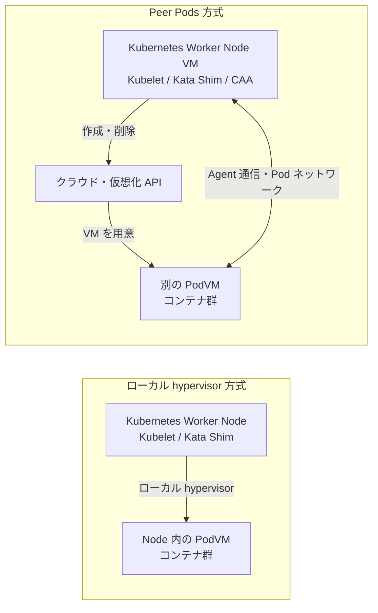
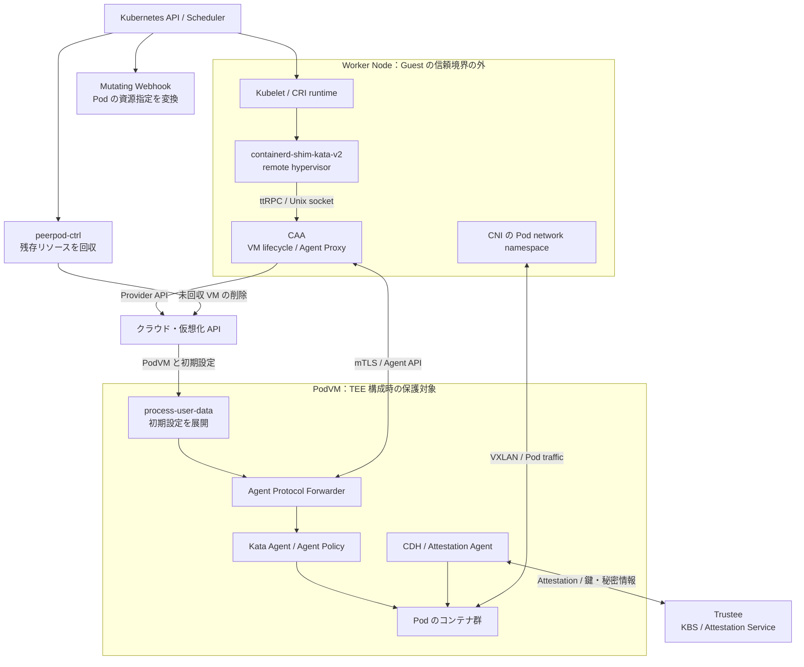
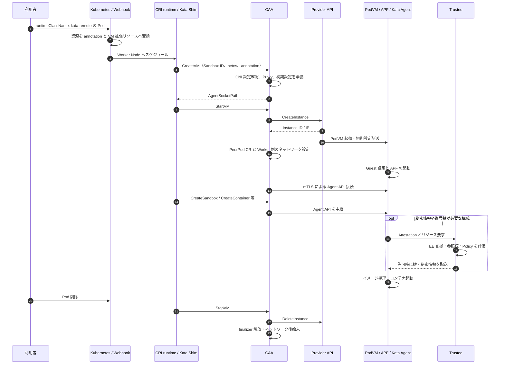
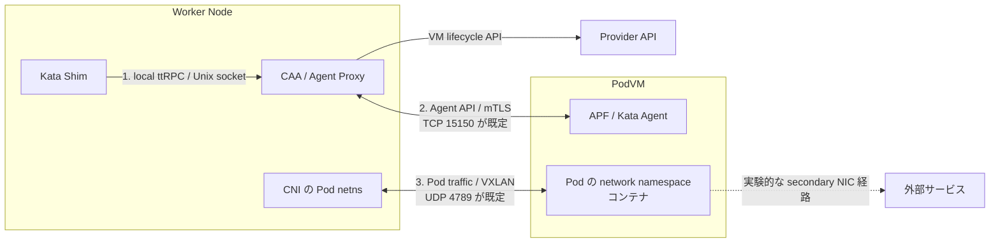
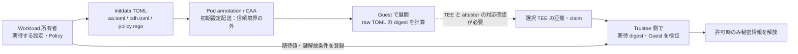

# Confidential Containers における cloud-api-adaptor 技術調査

- 調査日：2026-10-21（日本時間）
- 対象：Confidential Containers（CoCo）の Peer Pods と Cloud API Adaptor（CAA）
- 方法：公式 GitHub のソース、設定、設計文書、リリース情報の読解。クラウドへのデプロイ・実 TEE での検証・性能測定は未実施。
- ソースの基準：CAA main の `2c15720affbf63288b2db91f41356e0558bbdaec`。コミッター日時は 2026-10-19 16:49:51 UTC（2026-10-20 01:49:51 JST）。
- 最新の正式リリース：**v0.23.0**、2026-09-23 公開。タグの commit は `e3e0f00480b41c08e3e4dbc6b64aba7722fb65f9`。
- 本文の「実装確認」は上記 main の静的確認を指す。main の機能・設定を、そのまま v0.23.0 の保証とは扱わない。
- 追跡用：[参照ソース一覧と blob SHA](../assets/cloud-api-adaptor-sources-2026-10-21.json)

## 1. 結論

**CAA は、Kata Containers が Pod 用 VM を別のマシンに起動するための remote hypervisor 実装である。** Worker Node の中で QEMU 等を起動する代わりに、クラウド／仮想化基盤の API で PodVM を用意する。これが CoCo の **Peer Pods** という配置方式を実現する。[S1]

この構成では、Kubernetes が認識する Pod と、それを実行する VM の物理的な場所が分かれる。Pod は通常どおり Worker Node にスケジュールされるが、コンテナ本体は別の PodVM 内で動く。Worker Node に bare metal や nested virtualization を要求しないことが主要な利点である。一つの Pod Sandbox に一つの VM を対応させ、その Pod 内のコンテナが VM を共有する。[S1]

ただし、**Peer Pods として起動しただけでは、機密実行の条件は満たされない**。利用する VM の TEE 設定、検証可能な PodVM イメージ、Attestation と鍵解放ポリシー、Guest 内で実行を制限する Agent Policy を組み合わせる必要がある。CAA は VM の作成と通信を担い、Attestation の検証・秘密情報の解放は Trustee 等が担う。[S17] [S18] [S39]

本調査で導入判断に直結する点は次のとおり。

| 論点 | 確認した内容 | 導入への意味 |
|---|---|---|
| 起動コスト | 基本方式は Pod Sandbox ごとにクラウド VM を確保 | 短命・小粒な処理では VM 起動時間と課金粒度を評価する |
| 通信 | Agent API は mTLS、Pod ネットワークは VXLAN | 制御通信の TLS とアプリ通信の保護を別々に設計する |
| リソース | Webhook が CPU／メモリ等を annotation に変換し、VM 数を拡張リソースで管理 | 通常の Pod と同一の資源会計だと考えない |
| 信頼境界 | Worker Node、CAA、クラウドの初期設定配送は信頼境界の外 | 機密鍵を user-data に置かず、Guest と workload を検証して解放する |
| Agent Policy | CAA 文書に記載された既定の Policy は allow-all | 実 workload 用の制限と、その Policy の真正性確認が必要 |
| 対応環境 | main には 8 系統の provider 実装が存在 | provider の存在と TEE 対応・実運用検証済みを区別する |

根拠：起動コストは [S1]、通信は [S5]〜[S8]、資源管理は [S9]〜[S11]、信頼境界と Policy は [S17] [S18]、providers は第 8 節の各実装。

## 2. なぜ Peer Pods が必要か

### 2.1. ローカル VM 方式と配置の違い



図は配置の比較であり、どちらも実際の機密性は TEE と構成に依存する。Peer Pods の「Peer」は、PodVM が Worker Node の内側にネストせず、別の VM として配置されることを表す。PodVM を新しい Kubernetes Worker Node として登録する設計ではない。[S1]

### 2.2. 解決する課題と増える運用要素

クラウドの Kubernetes Worker Node は通常 VM である。その内部でもう一段 TEE VM を起動できるかはクラウド／CPU／仮想化の条件に左右される。Peer Pods はクラウドが提供する VM 起動 API を利用することで、この配置上の制約を回避する。[S1]

一方で、VM 作成 API の待ち時間、リージョンごとの容量・Quota、PodVM イメージの登録、ネットワーク経路、VM の後始末が新たな依存関係になる。Worker Node を小さくできても、PodVM 側の CPU・メモリ・ディスクの費用は発生する。bare metal 方式より常に安いとは断定できない。後半の費用・容量への示唆は、この配置からの設計上の推論であり、価格比較の実測結果ではない。

## 3. 構成要素と責務



保護対象として描いた Guest は、TEE が有効で、期待した Guest が Attestation によって確認できる場合を表す。図のネットワーク線すべてが TEE により暗号化されるわけではない。

| 要素 | 配置 | 主な責務 |
|---|---|---|
| Kata Shim | Worker Node | CRI runtime と Guest の仲介。remote hypervisor に VM の lifecycle を要求 |
| CAA | 対象 Node の DaemonSet | VM 設定生成、provider 呼出し、ネットワーク設定、Agent Proxy |
| Cloud Provider 実装 | CAA の provider 層 | VM の作成・削除、イメージやサイズ、IP 等の基盤固有処理 |
| Mutating Webhook | Kubernetes 内 | 対象 RuntimeClass の Pod の資源指定を VM 用に変換 |
| peerpod-ctrl | Kubernetes 内 | PeerPod CR と finalizer を利用した後始末 |
| process-user-data | PodVM | metadata／cloud-init 等で渡された設定の処理、initdata 展開 |
| Agent Protocol Forwarder（APF） | PodVM | ネットワーク越しの Agent API を受け、Kata Agent 側へ中継 |
| Kata Agent | PodVM | Sandbox／コンテナ／プロセスの操作と、構成時の Agent Policy 検査 |
| AA / CDH | PodVM | 証拠取得、Attestation、秘密情報取得、イメージ関連の機密処理 |
| Trustee | 信頼できる別サービス | 証拠・参照値・ポリシーの検証と秘密情報の解放 |

AA は Attestation Agent、CDH は Confidential Data Hub、KBS は Key Broker Service。CAA が KBS の代わりに鍵を判断して解放する構造ではない。[S1] [S2] [S12] [S18] [S39]

Provider の共通インターフェースには `CreateInstance`、`DeleteInstance`、`Teardown`、`ConfigVerifier` がある。実装を追加して VM 基盤を拡張する設計だが、対応するイメージ、ネットワーク、controller 側の回収処理も必要になる。[S19] [S12]

## 4. Pod 起動から停止までのフロー

### 4.1. 正常系



ここで Attestation は機密リソース利用時の概念フローを示す。すべての Pod 起動が無条件に Trustee の検証を通過する、という CAA の保証を示していない。検証を強制する鍵解放ポリシーを別途設計する。[S18] [S39]

### 4.2. コード上の区切り

main の `cloud.go` では、**CreateVM と StartVM の役割が異なる**。[S2]

1. **CreateVM**：Pod 名・Namespace・Sandbox ID の確認、既存 CNI network namespace の検査、CPU／メモリ／image 等の読出し、TLS と APF の設定、imagePullSecrets、initdata の準備を行う。Sandbox を保持し、`AgentSocketPath` を返す。
2. **StartVM**：provider の `CreateInstance` を呼ぶ。Instance ID を使って PeerPod CR を作成し、IP を用いて Worker 側のネットワークを設定する。Agent Proxy を起動して応答する。
3. **その後の Agent API**：Shim が AgentSocketPath を利用して送る要求を CAA の Proxy と PodVM の APF が中継する。
4. **StopVM**：Proxy 停止、provider の削除処理、PeerPod の解放、ネットワークの Teardown、Sandbox 情報の破棄を行う。

**StartVM の成功と「アプリが機密条件を満たして Ready になったこと」は異なる。** 実装の Ready 判定は Agent Proxy 側の起動に関係する。Guest のアプリ起動、鍵取得、readinessProbe は後続の確認対象になる。[S2] [S4]

Kata 側の `remote.go` でも、CreateVM の応答から AgentSocketPath を保存し、StartVM を別の呼出しとして扱っている。CAA の概要文書にある「Sandbox 作成で VM を起動」という説明を、API 名まで同じ意味だと解釈しない。[S38]

### 4.3. 削除失敗時

通常の VM 削除が成功すると CAA が PeerPod の finalizer を解放する。失敗して finalizer が残れば、Pod の ownerReference を介した削除処理で peerpod-ctrl が VM 回収を試みる。[S12]

ただし、これは全障害に対する完全な回収保証ではない。main では PeerPod CR の作成失敗がログ出力だけで処理を継続する箇所がある。また StopVM は削除失敗をログに出した後でも正常応答を返し得る。そのため、**Pod の削除完了だけで課金リソースの解放を判断しない**。VM、NIC、ディスク、IP 等を provider ごとに照合する運用が必要である。[S2]

BYOM では DeleteInstance は VM の破棄ではなく、再起動を促してプールへ返す処理である。「削除」という共通 API 名だけで物理的な動作を推定しない。[S27]

## 5. ネットワークは三つの経路として理解する



| 経路 | 目的 | 保護・確認事項 |
|---|---|---|
| ローカル制御 | Shim → CAA、Shim → Agent Proxy | Unix socket の権限と Node 側の制御 |
| Agent API | CAA Proxy ↔ APF | mTLS が通常の既定。APF の既定 TCP port は 15150 |
| Pod のアプリ通信 | Worker の CNI network ↔ Guest 内の Pod | VXLAN の既定 UDP port は 4789。VXLAN 自体は暗号化機構ではない |
| Provider API | VM 作成・削除 | provider identity、権限、API 到達性 |
| Attestation・イメージ取得 | Guest ↔ Trustee／Registry | Guest からの DNS・経路、検証ポリシー、TLS／証明書設定 |

port はコード上の既定値であり、設定により変更できる。Agent API を VXLAN と同一の経路・同一の暗号化範囲として扱わない。PodVM の基盤 IP と、Kubernetes が Pod に割り当てる Pod IP も別の概念である。[S3] [S5] [S7]

既定経路では Pod traffic を Worker Node 経由に戻すため、既存 CNI の資源・経路と接続する。ただし、特定 CNI での NetworkPolicy、Service、DNS、MTU の動作は環境ごとの検証対象である。[S1] [S8]

### 実験的な外部通信経路

main の `external-network.md` は、`EXTERNAL_NETWORK_VIA_PODVM`／`ext-network-via-podvm` により secondary NIC から外部へ出す機能を記載している。文書上の対象は AWS、Alibaba Cloud、Azure であり、実験的機能とされる。[S8]

この経路を通る egress は Worker Node を迂回するため、**Worker の CNI が適用する egress NetworkPolicy が効かない**。クラスタ Pod／Service の CIDR を VXLAN 側へルーティングする設定、provider の Security Group／NSG 等による出口制御を含めて評価する。通常経路の NetworkPolicy 試験結果を、そのままこの機能の有効時へ流用しない。[S8]

## 6. リソース管理と VM サイズ選択

### 6.1. Kubernetes が数えるもの

通常の Pod と異なり、コンテナの主要な CPU／メモリ使用は Worker Node の外で発生する。Webhook は対象 RuntimeClass の Pod に対して次の変換を行う。[S9] [S10]

- CPU／メモリ／GPU の要求を集計し、VM 選択用 annotation に記録する。
- containers と initContainers の `resources` を除去する。
- 最初のコンテナに拡張リソース `kata.peerpods.io/vm: 1` の request／limit を設定する。
- Worker Node に残る Shim 等の負荷は RuntimeClass の Pod overhead で別途考慮する。

既定の VM 数上限は `PEERPODS_LIMIT_PER_NODE=10`。これは**Node あたりの PodVM スロット数**であり、クラウド全体の vCPU Quota や TEE インスタンスの空き容量を予約するものではない。[S9]

### 6.2. annotation の正確な名前

| annotation | 意味 |
|---|---|
| `io.katacontainers.config.hypervisor.machine_type` | provider 側の instance type／flavor を明示 |
| `io.katacontainers.config.hypervisor.default_vcpus` | vCPU 数 |
| `io.katacontainers.config.hypervisor.default_memory` | メモリ MiB |
| `io.katacontainers.config.hypervisor.default_gpus` | GPU 数 |
| `io.katacontainers.config.hypervisor.image` | provider が解釈する PodVM image 指定 |
| `io.katacontainers.config.hypervisor.cc_init_data` | initdata |

resource-management 文書には `default_mem` という記載があるが、Webhook 定数と CAA 側の読出し、instance-selection 文書は **default_memory** を使用する。本レポートでは実装に合わせた。[S9] [S10] [S14]

共通の `SelectInstanceTypeToUse` は、明示した machine_type → GPU 条件 → **vCPU とメモリの両方が非ゼロの場合の選択** → provider の既定値、という順で分岐し、許可された instance type のリストを検査する。これを「どの provider でもメモリだけ指定すれば自動で最適化する」とは解釈しない。PowerVS は独自のサイズ決定処理を持ち、vCPU とメモリの指定を machine_type より優先する。[S11] [S25]

Hypervisor annotation の反映には Kata 側の許可設定も関係する。main の Helm values には `allowedHypervisorAnnotations: []` があるため、Pod に annotation を書いた事実だけで採用されたとは判断せず、runtime 設定と最終的な VM サイズ／image を照合する。[S29]

### 6.3. 運用への影響

Webhook は集計した VM サイズへ変換するため、通常のコンテナ単位の request／limit、QoS、namespace の資源制限、監視・課金の読み方を再確認する必要がある。GPU の annotation があることも、GPU の confidential computing 対応を保証しない。CPU TEE、GPU、driver、Attestation、対応イメージの組合せは別途検証する。

この段落は Webhook の変換動作からの設計上の示唆であり、すべての Kubernetes バージョンでの QoS 挙動や GPU 保護を実機確認した結果ではない。

## 7. 機密性のための信頼境界

### 7.1. CAA の外側・内側

CoCo の保護対象は PodVM 内の workload とそれを支える Guest stack である。Worker Node、Shim、CAA、クラウドの metadata／user-data 配送は Guest の信頼境界の外にある。CAA の脅威分析も、CAA と metadata service を untrusted と置き、機密の秘密情報は Attestation を介して取得する前提を明示する。[S18] [S39]

つまり、**CAA が正しい VM を作成したと申告することと、期待した Guest が起動していることの暗号学的な検証は別である**。

### 7.2. mTLS の役割と限界

CAA ↔ APF の mTLS は Agent API の通信相手認証と暗号化に使われる。自動設定では CAA が鍵・証明書を生成し、サーバー証明書と秘密鍵を初期設定として Guest へ配送する。[S6]

Worker Node に TLS の鍵・セッション状態が存在する以上、mTLS を有効にするだけで悪意ある Worker 管理者から Agent API 内容を隠せるとはいえない。アプリの機密鍵、復号鍵、データは Attestation に結び付いた Guest への配送を使う。アプリ通信はアプリ側の TLS 等で別途保護する。[S6] [S18]

また CreateVM の実装は imagePullSecrets を取得し、サイズ制限内なら `/run/peerpod/auth.json` として cloud-config に含める。Registry の認証情報も初期配送経路で扱われ得るため、クラウド管理者からの機密性が必要な認証情報を、この経路に無条件で置かない。[S2]

### 7.3. initdata で何を固定するか

initdata は AA 設定、CDH 設定、Agent Policy 等をまとめる初期設定である。[S13]



コードと文書から追える処理は次のとおり。[S2] [S13]〜[S16]

1. Pod manifest の `cc_init_data` には、文書上 gzip 後に base64 化した initdata を指定する。
2. Kata runtime から CAA へは raw string として渡る前提であり、CAA の `GetInitdataFromAnnotation` は再度 gzip／base64 化する。Pod manifest と CAA API 内部の形式を混同しない。
3. Pod 固有の値がなければ、CAA のグローバル `INITDATA` を利用できる。
4. Guest の process-user-data が `aa.toml`、`cdh.toml`、`policy.rego` を許可されたパスへ展開する。
5. gzip／base64 を復号した**元の TOML のバイト列**に対して、指定の sha256／sha384／sha512 で digest を計算し、`/run/peerpod/initdata.digest` に保存する。

**digest ファイルが存在するだけでは、TEE 証拠との結合も KBS の認可も確認できない。** 選んだ TEE と attester が期待する claim にその値をどう結び付けるか、その claim を Trustee の Policy が検査するかを追う必要がある。公式文書には IBM SE の `se.user_data` を照合する例があるが、この例を全 TEE 共通の claim 名・保証へ一般化しない。[S13]

digest は raw TOML に依存するため、改行・空白の差も期待値との差になる。KBS の URL／信頼する証明書と Policy を所有者の意図へ結び付け、変更された設定では鍵が解放されないことを負例で検証する。[S15]

### 7.4. 正しい Guest イメージだけでは workload は決まらない

CAA の脅威分析は、正しい PodVM イメージに悪意ある Pod を載せて秘密情報を得る攻撃を挙げ、Agent Policy と信頼できるイメージ制約を必要な対策としている。[S18]

CAA の Policy 文書は既定の `DEFAULT_AGENT_POLICY_FILE` を `allow-all.rego` と記載する。したがって、Agent Policy 機能が存在することを、workload の image／command／mount／exec 等が制限されている証拠と扱わない。実際の Guest ビルドで機能が有効か、Policy がロードされたか、期待した要求を拒否するかを確認する。[S17] [S40]

Kata の一般文書にあるローカル方式の initdata block device の説明は、CAA の配送経路と異なる。Peer Pods では CAA の initdata／user-data 実装を併せて読む。[S13] [S40]

### 7.5. 保護範囲の整理

| 対象 | 確認・設計すべきもの |
|---|---|
| Guest メモリ | 対応 TEE が有効な VM、証拠の検証、debug 状態や TCB 等の条件 |
| workload の内容 | 期待したイメージと操作を制約する Policy、署名／digest、改変時の拒否 |
| 鍵・秘密情報 | 検証結果に基づく解放条件と Guest への配送 |
| 通信 | Agent API の mTLS と、アプリの TLS／認証 |
| 永続データ | ストレージの暗号化・鍵管理・Guest への接続方法 |
| 可用性 | API 障害、容量不足、Node 障害、クラウド管理者による停止への対応 |

TEE によるメモリ保護を、通信・ディスク・可用性への一括保証として扱わない。ストレージも、ローカル hypervisor のファイル共有やデバイス接続の構成を、そのまま別 PodVM へ適用できるわけではない。main には cloud volume attachment を扱う経路があるが、CSI driver と provider の組合せ、暗号化鍵の取得、Pod 削除後のデータ保持を個別に検証する。[S2] [S20] [S21]

## 8. 対応 provider と TEE の読み分け

以下は main の provider ディレクトリと実装を基準にした整理である。商用サポート表、全リージョンでの提供表、e2e 合格表ではない。

| provider | コードで確認した構成 | 機密実行についての注意 |
|---|---|---|
| AWS | EC2 の起動。CVM 有効時に AMD SEV-SNP CPU option を設定 | 対応 instance type、UEFI 対応 AMI、region、SNP 証拠と Guest を確認 [S20] |
| Azure | CVM 有効時は ConfidentialVM。無効時は TrustedLaunch | TrustedLaunch と ConfidentialVM を同一視しない。VM SKU、image security type、attester を照合 [S21] |
| GCP | CVM 有効時に ConfidentialType を要求し confidential compute を設定 | provider 設定文書は TDX／SEV／SEV_SNP を例示。CPU 技術ごとの保証と証拠を分ける。実装は CVM の maintenance を TERMINATE に設定 [S22] [S42] |
| Alibaba Cloud | CVM 有効時の TDX 設定 | 対応 ECS instance、image、Guest の TDX attester を確認 [S23] |
| IBM Cloud VPC | TDX confidential compute mode を設定、DisableCVM で disabled に変更 | 対応 profile、image、証拠を照合 [S24] |
| IBM Cloud PowerVS | VM のサイズ・イメージ・ネットワークを指定する実装あり | 今回の読解で CPU TEE を有効化する同等の設定は確認していない。存在だけで CoCo の機密性を主張しない [S25] |
| libvirt | CGO／libvirt を使う。launch security の検出は s390x の S390PV を対象 | main の検出は非 s390x で NoLaunchSecurity。x86 の SNP／TDX 対応をこの実装から推定しない [S26] [S43] |
| BYOM | 事前作成 VM のプールを割り当て、SSH／SFTP で初期設定を渡す | CAA が新規の TEE VM を必ず生成する方式ではない。VM 作成・再利用時の保護と消去は別途評価 [S27] [S28] |

**README の provider 一覧だけでは現状を把握できない。** CAA サブディレクトリの README は aws／azure／ibmcloud／libvirt の 4 件を挙げる一方、main の実装には上記 8 系統が存在する。逆に Helm のコメントや providers 配下には vsphere の記述・ファイルが残るが、今回の main の組込み provider 実装ディレクトリには vsphere が存在しない。設定ファイルが残っていることを利用可能性の根拠にしない。[S29] [S37] [S44]

BYOM の SSH host key は、allowlist 未設定時の既定が stateless TOFU とされ、文書上は接続時の任意の host key を受け入れる。運用では別の信頼できる経路で収集・確認した host key の allowlist を使い、さらに TEE の Attestation を検証する。SSH の相手認証と TEE の検証は役割が異なる。[S28]

## 9. リリースと main の差分で注意する点

| 項目 | 2026-10-21 に確認した状態 |
|---|---|
| 正式リリース | v0.23.0、2026-09-23 公開 |
| v0.23.0 の Helm chart | chart version 0.5.0、appVersion v0.23.0、kata-deploy 4.2.0 |
| main の Helm chart | chart version 0.5.0、appVersion v0.23.0 のまま、kata-deploy 0.0.0-dev |
| main の共通 image 設定 | ghcr.io/confidential-containers/cloud-api-adaptor、tag latest。libvirt は dev variant が必要 |
| v0.23.0 の通知 | encrypted scratch-space を非推奨化。0.24 で削除する可能性。イメージ配布を quay.io から GHCR のみに移す手続きを開始 |
| main の PodVM build | mkosi を使用。既定ビルドは filesystem attester のみ。TEE_PLATFORM で必要な attester を選ぶ |

根拠：[S29] [S31] [S32] [S34] [S41] [S45]

**chart の version や appVersion が同じでも依存関係が一致するとは限らない。** 再現性のために CAA source commit、chart の取得元と digest、Kata／guest-components、PodVM image ID／digest、Guest の Policy を一緒に記録する。main の `versions.yaml` の pin は main でのビルド用情報であり、過去の release の値を代表しない。[S35]

リリースノートの「0.24 で削除する可能性」を、今回確認した時点で削除済みと表現しない。また quay.io の既存イメージがすべて削除されたとの確認は行っていない。[S41]

## 10. 導入・検証の進め方

以下は**未実行の検証計画**である。クラウドの VM／image／network は作成しておらず、実環境の成功を報告するものではない。

### 10.1. 先に決める構成

1. **provider と TEE**：region、instance type、image の形式、Attestation の種類を確定する。
2. **資源と identity**：VM 数／vCPU／ディスク等の Quota、CAA／controller の最小権限を確保する。
3. **ネットワーク**：Worker ↔ PodVM、Guest ↔ Registry／Trustee、DNS、Pod／Service CIDR、MTU を確認する。
4. **Guest**：APF、Kata Agent、AA／CDH、attester、起動設定、Agent Policy を含む PodVM image を用意する。
5. **鍵解放条件**：期待する Guest と initdata／Policy の値、秘密リソースごとの認可条件を登録する。
6. **版の固定**：release を基準にし、source commit と配布物の digest を記録する。

CAA の DaemonSet は main のテンプレートで hostNetwork、NET_ADMIN／SYS_ADMIN capability、hostPath mount を使用する。導入時には対象 Node の管理権限を必要とするコンポーネントとして配置を計画する。cert-manager は既定有効の Webhook の前提条件である。[S30] [S32]

### 10.2. release を基準にした手順の骨格

下記は Linux shell 用の例であり、PROVIDER、provider-values.yaml、既存 Secret、イメージ等を環境に合わせて用意してから使用する。実行済み手順ではない。認証方式によっては Workload Identity 等を使えるため、必ず固定キーの Secret が必要という意味ではない。

```bash
git clone --branch v0.23.0 --single-branch \
  https://github.com/confidential-containers/cloud-api-adaptor.git
cd cloud-api-adaptor
git rev-parse HEAD
# 期待値: e3e0f00480b41c08e3e4dbc6b64aba7722fb65f9

cd src/cloud-api-adaptor/install/charts/peerpods
# provider ごとの既存 Secret と設定ファイルを別途用意する。
# PROVIDER は aws / azure / gcp 等、対象環境の値に設定する。
# provider-values.yaml には region、network、PodVM image 等を記載する。
helm dependency update .
helm template peerpods . \
  -f "providers/${PROVIDER}.yaml" \
  -f provider-values.yaml \
  --set secrets.mode=reference \
  --set secrets.existingSecretName=caa-provider-creds \
  -n confidential-containers-system > rendered.yaml
```

レンダリング結果で runtimeClass、対象 Node、provider 設定、CAA image、Secret 参照、controller／Webhook が意図どおりであることを確認する。その後、同じ値で Helm を適用する。依存 chart の取得結果も固定・記録する。[S32] [S33] [S45]

main の Helm 文書は `secrets.mode=reference` を運用向けとして説明する。`create` で秘密値を渡すと Helm release history に保存され、`helm get values` で取得され得る。秘密値を調査リポジトリへ保存せず、Secret 名や使用する identity の設計を記録する。[S29] [S32]

Kata／CAA のみを確認する最初の Pod は、公開イメージで疎通を確認できる。ただし、これを機密実行の合格としない。続いて TEE と Attestation、実 workload の Policy を組み込む。

```yaml
apiVersion: v1
kind: Pod
metadata:
  name: peerpod-connectivity-test
spec:
  runtimeClassName: kata-remote
  restartPolicy: Never
  containers:
    - name: test
      # 実際の検証では承認した image digest に固定する。
      image: registry.k8s.io/pause:3.9
      resources:
        requests:
          cpu: "1"
          memory: "1Gi"
```

これは scheduling と VM 作成を見るための最小例であり、TEE 選択、initdata、鍵解放を含んでいない。適用後に admission 後の Pod annotation と resources、クラウド側 VM の実サイズを照合する。[S9] [S10]

### 10.3. 検証項目と合格条件

| ID | 試験 | 合格条件・保存する証跡 |
|---|---|---|
| V01 | RuntimeClass と admission | kata-remote の Pod だけが変換され、default_memory 等と VM=1 が記録される |
| V02 | サイズ選択 | Pod の指定と実 VM の vCPU／メモリ／instance type を照合できる |
| V03 | VM 起動と対応関係 | Pod UID／Sandbox ID、PeerPod CR、Instance ID の対応が追える |
| V04 | 制御・アプリ通信 | APF への mTLS、Pod IP、Service／DNS／MTU が想定どおり動く |
| V05 | 実 TEE | クラウド設定と真正な証拠で TEE・期待 Guest・必要な TCB 条件を確認する |
| V06 | Attestation 正例 | 正しい証拠と認可条件の場合に限り機密リソースを取得できる |
| V07 | 非 TEE／不一致証拠 | non-CVM、期待外の Guest／TCB／debug 条件では秘密情報が解放されない |
| V08 | initdata 改変 | Policy／KBS 設定を変えると期待 digest と一致せず、機密リソース取得に失敗する |
| V09 | workload 改変 | 不許可 image／command／exec／mount が Agent Policy 等で拒否される |
| V10 | NetworkPolicy | 通常経路の ingress／egress を確認。外部 NIC 有効時も別途検証する |
| V11 | 正常削除・異常系回収 | Pod／VM 削除、CAA 再起動、API 障害を試し、VM／NIC／disk／IP の残存を照合する |
| V12 | 更新と容量 | CAA rolling update、PodVM image 切替、Quota 枯渇時の挙動と復旧を確認する |
| V13 | ストレージ | 対応 volume の接続、Guest の復号、鍵拒否時の失敗、再利用時のデータ隔離を確認する |
| V14 | BYOM を使う場合 | 同時割当、返却・再起動・清掃、host key 不一致の拒否、再 Attestation を確認する |

ここに記載した「合格条件」は提案であり、合格済みという意味ではない。特に V05〜V09 を、Pod が Running になったことだけで代替しない。

### 10.4. 性能・費用の測定

Pod のスケジュール開始、クラウド CreateInstance 完了、Guest 到達、イメージ処理、Attestation／鍵取得、アプリ Ready を分けて時刻を記録する。warm／cold、イメージキャッシュ、同時起動数、VM サイズ、region を揃え、p50／p95 の起動時間と処理時間を測る。

費用は Worker Node に加え、PodVM の起動から実リソース解放まで、disk、IP、network、ログ等を含めて集計する。BYOM のプール待機費用も含める。本調査は性能数値や料金の見積りを提供していない。

## 11. 障害の切り分け

| 症状 | 最初に確認する場所 |
|---|---|
| Pending のまま | VM 拡張リソースの allocatable／上限、Webhook、RuntimeClass、Node selector |
| VM が作成されない | CAA logs、provider identity／権限、Quota、region／instance type／image の組合せ |
| VM は存在するが Sandbox 起動失敗 | APF の起動、15150/TCP、初期設定、Guest log、証明書・TLS profile |
| Pod IP はあるが通信不可 | VXLAN、4789/UDP、CNI／route、MTU、Pod／Service CIDR |
| コンテナ起動や鍵取得に失敗 | Guest の image pull、Registry 認証、AA／CDH、KBS endpoint、Policy 拒否理由 |
| Pod 削除後も費用が残る | PeerPod CR／finalizer、peerpod-ctrl、provider 削除エラー、孤立リソース |
| Debug VM が残る | PODVM_DEVELOPER_MODE と、残存 VM の明示的な管理 |

main には `PODVM_DEVELOPER_MODE=true` で StopVM 時に VM を残す機能があり、このモードでは上限の既定が 1 になる。障害調査には有用だが、通常削除の前提と異なるため、残存 VM の棚卸しを行う。[S36]

CAA／controller の健全性確認と、Guest 内の保護条件の確認を分ける。収集する Guest のログや証拠にも機密情報を混ぜず、レポートには秘密値を含まない識別子と結果を保存する。

## 12. 導入判断と未解決事項

Peer Pods は、VM ベースの Worker Node や managed Kubernetes と、Pod ごとの TEE VM を組み合わせるための有力な構成である。長時間動く workload や、Pod 単位の VM 隔離が必要な用途は検討対象になる。一方で、起動時間に厳しい短命処理、クラウド API／Quota の依存を避けたい用途では、ローカル hypervisor 方式との比較が必要になる。[S1]

今回の調査から、次の順で確認すると判断しやすい。

1. **配置が成立するか**：対象 provider、Worker／PodVM、ネットワークとイメージ。
2. **機密条件を強制できるか**：TEE、Attestation、initdata の結合、Agent Policy、鍵解放の負例。
3. **運用できるか**：更新、回収、容量、ストレージ、監視、費用。
4. **要求性能を満たすか**：起動・通信・処理時間の実測。

今回未確認なのは、特定の実クラスタ／クラウドでの e2e 成功、全 provider の機能互換性、実際のイメージ配布物の digest と内容、各 TEE での initdata claim の結合、最新 main 全体の CI 合格状態である。これらを文献の記載から成功済みと推定していない。

関連資料：

- [Confidential Containers 全体調査](../../confidential-containers/reports/confidential-containers-system-architecture-2026-10-19.md)
- [Trustee の調査一覧](../../trustee/README.md)
- [CAA の資料一覧](../README.md)

## 参照した一次情報

S1〜S37、S42〜S44 は CAA の調査対象 main commit に固定した。S38／S40 は、その main の versions.yaml が参照する Kata commit を使用する。S39 は公式設計文書、S41 は release 情報、S45 は release commit に固定した chart。GitHub の blob SHA と参照 URL は [ソース一覧](../assets/cloud-api-adaptor-sources-2026-10-21.json) に記録する。

- [S1] Peer Pods の構成・設計上の制約
- [S2] CreateVM / StartVM / StopVM の実装
- [S3] remote hypervisor の Unix socket / ttRPC
- [S4] Worker 側 Agent Proxy
- [S5] APF / TCP 15150
- [S6] mTLS と初期鍵配送の信頼モデル
- [S7] VXLAN / UDP 4789
- [S8] 実験的な外部通信経路と NetworkPolicy
- [S9] 拡張リソースと Pod overhead
- [S10] Webhook の正確な annotation 名・変換
- [S11] 共通の instance type 選択ロジック
- [S12] PeerPod CR・finalizer による回収
- [S13] initdata の指定と展開
- [S14] Kata からの initdata 再エンコード
- [S15] initdata のハッシュ対象
- [S16] initdata のファイル展開と digest 作成
- [S17] Agent Policy の既定値
- [S18] 初期設定配送と workload 制約の信頼モデル
- [S19] Provider インターフェース
- [S20] AWS の VM 起動と SEV-SNP オプション
- [S21] Azure CVM / TrustedLaunch の選択
- [S22] GCP confidential type と maintenance 設定
- [S23] Alibaba Cloud TDX 設定
- [S24] IBM Cloud VPC TDX 設定
- [S25] PowerVS 実装・独自のサイズ選択
- [S26] libvirt の launch security 検出
- [S27] BYOM の VM pool 割当・返却
- [S28] BYOM の SSH host key 設定
- [S29] main のデプロイ設定
- [S30] DaemonSet の権限・hostNetwork・mount
- [S31] main の Helm 依存関係
- [S32] Helm・Secret 管理・image tag
- [S33] 導入手順・worker node label
- [S34] PodVM ビルドと attester
- [S35] main の Kata / guest-components 等の pin
- [S36] Developer Mode の残存 VM
- [S37] README の providers 一覧との比較
- [S38] Kata remote hypervisor の呼出し
- [S39] CoCo 公式設計概要
- [S40] Kata Agent Policy の適用と制限
- [S41] v0.23.0 リリースノート
- [S42] GCP の provider 設定
- [S43] libvirt の CVM 選択
- [S44] provider 実装と Helm provider ファイルの tree
- [S45] v0.23.0 の Helm chart 依存関係

[S1]: https://github.com/confidential-containers/cloud-api-adaptor/blob/2c15720affbf63288b2db91f41356e0558bbdaec/docs/architecture.md
[S2]: https://github.com/confidential-containers/cloud-api-adaptor/blob/2c15720affbf63288b2db91f41356e0558bbdaec/src/cloud-api-adaptor/pkg/adaptor/cloud/cloud.go
[S3]: https://github.com/confidential-containers/cloud-api-adaptor/blob/2c15720affbf63288b2db91f41356e0558bbdaec/src/cloud-api-adaptor/pkg/adaptor/server.go
[S4]: https://github.com/confidential-containers/cloud-api-adaptor/blob/2c15720affbf63288b2db91f41356e0558bbdaec/src/cloud-api-adaptor/pkg/adaptor/proxy/proxy.go
[S5]: https://github.com/confidential-containers/cloud-api-adaptor/blob/2c15720affbf63288b2db91f41356e0558bbdaec/src/cloud-api-adaptor/pkg/forwarder/forwarder.go
[S6]: https://github.com/confidential-containers/cloud-api-adaptor/blob/2c15720affbf63288b2db91f41356e0558bbdaec/src/cloud-api-adaptor/docs/tls-proxy-forwarder.md
[S7]: https://github.com/confidential-containers/cloud-api-adaptor/blob/2c15720affbf63288b2db91f41356e0558bbdaec/src/cloud-api-adaptor/pkg/podnetwork/tunneler/vxlan/workernode.go
[S8]: https://github.com/confidential-containers/cloud-api-adaptor/blob/2c15720affbf63288b2db91f41356e0558bbdaec/src/cloud-api-adaptor/docs/external-network.md
[S9]: https://github.com/confidential-containers/cloud-api-adaptor/blob/2c15720affbf63288b2db91f41356e0558bbdaec/src/cloud-api-adaptor/docs/resource-management.md
[S10]: https://github.com/confidential-containers/cloud-api-adaptor/blob/2c15720affbf63288b2db91f41356e0558bbdaec/src/webhook/pkg/mutating/remove-resourcespec.go
[S11]: https://github.com/confidential-containers/cloud-api-adaptor/blob/2c15720affbf63288b2db91f41356e0558bbdaec/src/cloud-providers/util.go
[S12]: https://github.com/confidential-containers/cloud-api-adaptor/blob/2c15720affbf63288b2db91f41356e0558bbdaec/src/peerpod-ctrl/README.md
[S13]: https://github.com/confidential-containers/cloud-api-adaptor/blob/2c15720affbf63288b2db91f41356e0558bbdaec/src/cloud-api-adaptor/docs/initdata.md
[S14]: https://github.com/confidential-containers/cloud-api-adaptor/blob/2c15720affbf63288b2db91f41356e0558bbdaec/src/cloud-api-adaptor/pkg/util/cloud.go
[S15]: https://github.com/confidential-containers/cloud-api-adaptor/blob/2c15720affbf63288b2db91f41356e0558bbdaec/src/cloud-api-adaptor/pkg/initdata/initdata.go
[S16]: https://github.com/confidential-containers/cloud-api-adaptor/blob/2c15720affbf63288b2db91f41356e0558bbdaec/src/cloud-api-adaptor/pkg/userdata/provision.go
[S17]: https://github.com/confidential-containers/cloud-api-adaptor/blob/2c15720affbf63288b2db91f41356e0558bbdaec/src/cloud-api-adaptor/docs/policy.md
[S18]: https://github.com/confidential-containers/cloud-api-adaptor/blob/2c15720affbf63288b2db91f41356e0558bbdaec/src/cloud-api-adaptor/docs/sftp_vs_metadata_approach_security.md
[S19]: https://github.com/confidential-containers/cloud-api-adaptor/blob/2c15720affbf63288b2db91f41356e0558bbdaec/src/cloud-providers/types.go
[S20]: https://github.com/confidential-containers/cloud-api-adaptor/blob/2c15720affbf63288b2db91f41356e0558bbdaec/src/cloud-providers/aws/provider.go
[S21]: https://github.com/confidential-containers/cloud-api-adaptor/blob/2c15720affbf63288b2db91f41356e0558bbdaec/src/cloud-providers/azure/provider.go
[S22]: https://github.com/confidential-containers/cloud-api-adaptor/blob/2c15720affbf63288b2db91f41356e0558bbdaec/src/cloud-providers/gcp/provider.go
[S23]: https://github.com/confidential-containers/cloud-api-adaptor/blob/2c15720affbf63288b2db91f41356e0558bbdaec/src/cloud-providers/alibabacloud/provider.go
[S24]: https://github.com/confidential-containers/cloud-api-adaptor/blob/2c15720affbf63288b2db91f41356e0558bbdaec/src/cloud-providers/ibmcloud/provider.go
[S25]: https://github.com/confidential-containers/cloud-api-adaptor/blob/2c15720affbf63288b2db91f41356e0558bbdaec/src/cloud-providers/ibmcloudpowervs/provider.go
[S26]: https://github.com/confidential-containers/cloud-api-adaptor/blob/2c15720affbf63288b2db91f41356e0558bbdaec/src/cloud-providers/libvirt/libvirt.go
[S27]: https://github.com/confidential-containers/cloud-api-adaptor/blob/2c15720affbf63288b2db91f41356e0558bbdaec/src/cloud-providers/byom/provider.go
[S28]: https://github.com/confidential-containers/cloud-api-adaptor/blob/2c15720affbf63288b2db91f41356e0558bbdaec/src/cloud-api-adaptor/byom/README.md
[S29]: https://github.com/confidential-containers/cloud-api-adaptor/blob/2c15720affbf63288b2db91f41356e0558bbdaec/src/cloud-api-adaptor/install/charts/peerpods/values.yaml
[S30]: https://github.com/confidential-containers/cloud-api-adaptor/blob/2c15720affbf63288b2db91f41356e0558bbdaec/src/cloud-api-adaptor/install/charts/peerpods/templates/daemonset.yaml
[S31]: https://github.com/confidential-containers/cloud-api-adaptor/blob/2c15720affbf63288b2db91f41356e0558bbdaec/src/cloud-api-adaptor/install/charts/peerpods/Chart.yaml
[S32]: https://github.com/confidential-containers/cloud-api-adaptor/blob/2c15720affbf63288b2db91f41356e0558bbdaec/src/cloud-api-adaptor/install/charts/peerpods/README.md
[S33]: https://github.com/confidential-containers/cloud-api-adaptor/blob/2c15720affbf63288b2db91f41356e0558bbdaec/src/cloud-api-adaptor/install/README.md
[S34]: https://github.com/confidential-containers/cloud-api-adaptor/blob/2c15720affbf63288b2db91f41356e0558bbdaec/src/cloud-api-adaptor/podvm/README.md
[S35]: https://github.com/confidential-containers/cloud-api-adaptor/blob/2c15720affbf63288b2db91f41356e0558bbdaec/src/cloud-api-adaptor/versions.yaml
[S36]: https://github.com/confidential-containers/cloud-api-adaptor/blob/2c15720affbf63288b2db91f41356e0558bbdaec/src/cloud-api-adaptor/docs/troubleshooting/README.md
[S37]: https://github.com/confidential-containers/cloud-api-adaptor/blob/2c15720affbf63288b2db91f41356e0558bbdaec/src/cloud-api-adaptor/README.md
[S38]: https://github.com/kata-containers/kata-containers/blob/d130fbdb929291c8c8c60cf5fdf7cbc7b06d02f9/src/runtime/virtcontainers/remote.go
[S39]: https://confidentialcontainers.org/docs/architecture/design-overview/
[S40]: https://github.com/kata-containers/kata-containers/blob/d130fbdb929291c8c8c60cf5fdf7cbc7b06d02f9/docs/how-to/how-to-use-the-kata-agent-policy.md
[S41]: https://github.com/confidential-containers/cloud-api-adaptor/releases/tag/v0.23.0
[S42]: https://github.com/confidential-containers/cloud-api-adaptor/blob/2c15720affbf63288b2db91f41356e0558bbdaec/src/cloud-api-adaptor/install/charts/peerpods/providers/gcp.yaml
[S43]: https://github.com/confidential-containers/cloud-api-adaptor/blob/2c15720affbf63288b2db91f41356e0558bbdaec/src/cloud-providers/libvirt/provider.go
[S44]: https://github.com/confidential-containers/cloud-api-adaptor/tree/2c15720affbf63288b2db91f41356e0558bbdaec/src/cloud-providers
[S45]: https://github.com/confidential-containers/cloud-api-adaptor/blob/e3e0f00480b41c08e3e4dbc6b64aba7722fb65f9/src/cloud-api-adaptor/install/charts/peerpods/Chart.yaml


