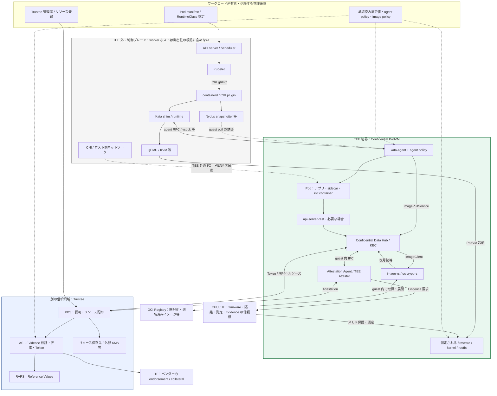
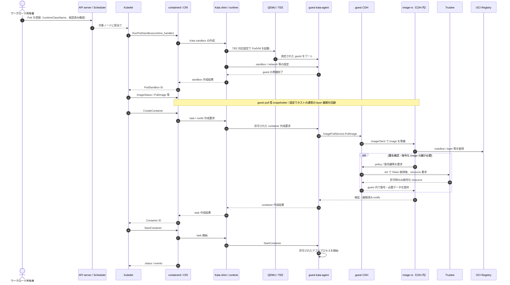
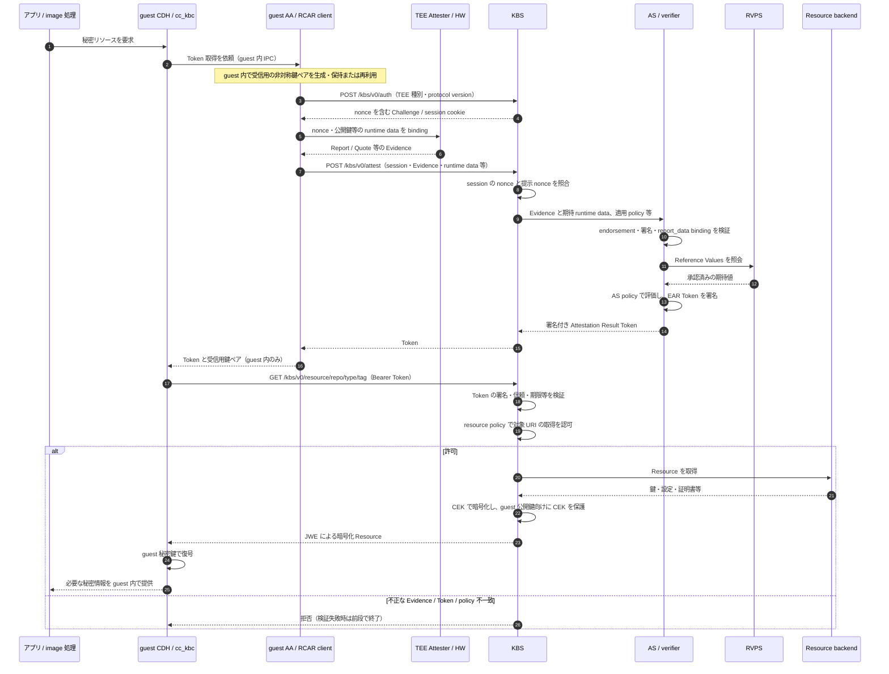
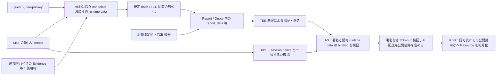
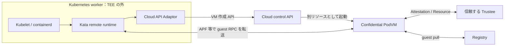

# Confidential Containers 全体システム俯瞰技術調査レポート

**調査・確認日：2026年10月19日（JST）**  
**対象：Kubernetes から Confidential VM 内のコンテナ、Trustee による Attestation と秘密情報配布まで**

本書は、公式 GitHub、リリースノート、公式 docs、実装を同日に取得して照合した技術調査である。「最新リリースに含まれる構成」と「開発ブランチの最新実装」を区別する。実機で Pod、Quote、秘密情報配布を動作確認した結果ではない。導入手順・異常系試験は今後の検証計画として示す。

## 1. 最初に押さえる全体像

Confidential Containers（以下 CoCo）は、Kubernetes の **Pod を Confidential VM（PodVM）に収容し、信頼しないホスト上でもワークロードとデータを保護する**仕組みである。Kata Containers の VM 実行機能に、TEE、ゲスト内でのコンテナイメージ取得、Attestation、条件付き秘密情報配布などを組み合わせる。[Overview][A0]・[Design Overview][A1]

役割を三つに分けると理解しやすい。

1. **Kubernetes／containerd／Kata のホスト側**は「どのノードで、どの PodVM を起動するか」を処理する。
2. **PodVM のゲスト側**はコンテナイメージを取得・検証・復号し、コンテナを実行する。kata-agent、image-rs、CDH、AA がここで働く。
3. **Trustee** はゲストが提示する Evidence を検証・評価し、許可された状態のゲストに必要なリソースだけを配布する。通常はワークロードのホストとは別の、所有者が信頼するサービスとして配置する。

メモリの暗号化だけで、この三つが自動的につながるわけではない。**保護された VM を起動し、期待したゲスト構成を測定値で確認し、ワークロードのイメージと操作をポリシーで制限し、その後に秘密を渡す**という連鎖を設計する。[Trust Model][A2]・[Trustee Architecture][T0]

### 1.1 2026年10月時点の重要な更新

| 項目 | 確認した現状 | 設計・導入への影響 |
|---|---|---|
| CoCo の導入 | 公式 Helm Chart が主経路。旧 CoCo Operator は非推奨・archive 済み | 古い `CcRuntime` CR を新規導入の標準にしない。Trustee Operator とは別のプロジェクト |
| CoCo 最新リリース | v0.23.0。ノート記載日は 2026-09-24、GitHub Release の公開日時は 2026-09-28 UTC | 記載日と公開日を混同しない |
| 組合せ | CoCo v0.23.0 は Kata 4.2.0、Trustee／guest-components v0.22.0、KBS protocol 0.4.0 を記載 | 各プロジェクトの版番号が同じになるとは限らない |
| Kata runtime | Kata 4.2.0 では多くの RuntimeClass で Rust shim が既定。一方 CoCo v0.23.0 は Go shim を継続すると明記 | 「Kata 4 系だから CoCo もすべて runtime-rs」と推定しない |
| 独立した上流の最新版 | Kubernetes v1.37.1、containerd v2.4.2 | CoCo がその組合せを検証済みという意味にはならない |

根拠：[CoCo v0.23.0 ノート][R1]、[Chart v0.23.0][R2]、[Chart.yaml][R3]、[Operator の非推奨通知][R5]、[Kata 4.2.0][R6]、[Kubernetes Release][K0]、[containerd Release][C0]。再現用の参照 SHA は第12節に記録する。

## 2. 全体構成とコンポーネント対応

### 2.1 全体構成図

図はベアメタルの worker 上で QEMU/KVM 系の PodVM を起動する代表構成である。線は主な論理接続を示し、すべてが直接のネットワーク API という意味ではない。とくに snapshotter から image-rs への要求は Kata のゲスト操作を経由する。[Design Overview][A1]・[Kata Architecture][R7]

**TEE 内に置くのは Kubernetes ノード全体ではなく、Pod とその実行に必要なゲスト OS・支援機能である。** 同一 Pod のコンテナは同じ VM の TCB と秘密情報保護の範囲を共有する。Kubelet、ホスト containerd、shim、VMM はこの境界の外に置かれる。これらの不正な要求に対してゲストが自ら制限を掛ける必要がある。[Trust Model][A2]

### 2.2 コンポーネント対応表

| 層・コンポーネント | 配置 | 担当する処理 | 主な接続・公式実装 |
|---|---|---|---|
| API server / Scheduler | 制御プレーン | Pod の受付、ノード選択。TEE Evidence 自体を検証する標準機能ではない | Kubernetes [RuntimeClass][K2] |
| Kubelet | worker ホスト | Pod の状態を維持し、sandbox／container 操作を CRI に要求 | Kubernetes [CRI][K1]・[sandbox 実装][K3] |
| CRI | API 境界 | RuntimeService と ImageService の gRPC インターフェース | 独立した VMM やプロセスの名前ではない [K1] |
| containerd / CRI plugin | worker ホスト | CRI を実装し、sandbox・task・image・snapshotter・runtime を調整 | [CRI 設定][C1] |
| Snapshotter | worker ホスト | rootfs snapshot 処理。CoCo 構成では通常のホスト展開を回避し guest pull に誘導 | [Nydus snapshotter][C3]・[Chart values][R4] |
| RuntimeClass / runtime handler | Kubernetes オブジェクト／ホスト設定 | `runtimeClassName` と CRI の handler を対応させる | `kata-qemu-tdx`、`kata-qemu-snp` 等。作成だけでは実TEEを証明しない [K2][A3] |
| Kata shim | worker ホスト | containerd runtime v2 と接続し、sandbox のライフサイクルと guest agent 呼出しを管理 | `containerd-shim-kata-v2` 等 [C2][R7] |
| Kata runtime / runtime-rs | 主に worker ホスト | PodVM の構成、VMM 制御、デバイス・ネットワーク等の準備 | Go／Rust の実装差・構成差がある。別プロセスが常に一段ずつ存在するとは限らない [R6][R7] |
| Hypervisor / VMM / KVM | ホスト user space／kernel | VM と vCPU・メモリ・デバイスを構成し、TEE モードで起動 | 代表例 QEMU + KVM。TEE 固有の起動設定が必要 [Q1][R9] |
| TEE / セキュリティ firmware | CPU・プラットフォーム | ゲスト隔離、測定、Report／Quote の信頼根 | TDX、SEV-SNP、IBM Secure Execution 等。対応範囲は構成依存 [A0][R1] |
| Guest firmware / kernel / rootfs | PodVM 内 | ゲストのブートとコンテナ実行基盤 | 測定・検証対象となる基盤。guest-components を含む rootfs／拡張イメージを使用 [A2][R9] |
| kata-agent | PodVM 内 | host からの sandbox／container RPC を受け、コンテナの生成・開始等を実行 | Kata の guest agent。AA とは別。agent policy により操作制限 [R7][A5] |
| image-rs | PodVM 内 | OCI image の取得・展開、署名確認等を扱う | [guest-components/image-rs][G3] |
| ocicrypt-rs / image encryption | PodVM 内／準備環境 | 暗号化 layer の処理。鍵の取得は CDH 等に依頼 | [Encrypted Images][G8] |
| CDH | PodVM 内 | image 復号鍵、秘密リソース、sealed secret 等の機密データ操作 | [Confidential Data Hub][G2] |
| KBC / KBS Protocol Client | PodVM 内のライブラリ等 | KBS の認証・リソース要求、鍵・Token・JWE 処理 | CDH／AA との分担は選択した client・方式による [G1][G4] |
| AA / TEE Attester | PodVM 内 | runtime data に対応する Evidence を TEE 経路から取得し、Token 取得を支援 | [Attestation Agent][G1] |
| api-server-rest（ASR） | PodVM 内、利用構成に応じる | アプリから CDH 等への REST の窓口 | 公開する API・アクセス元を制限 [G9] |
| KBS | 信頼する外部領域 | Challenge、AS 連携、Token 検証、resource policy、秘密情報の暗号化配布 | [Trustee][T1]・[KBS protocol][T2] |
| AS | 信頼する外部領域 | TEE Evidence の真正性・TCB・binding の検証、policy 評価、署名付き結果発行 | [Attestation Service][T5][T6] |
| RVPS | 信頼する外部領域 | Reference Value の登録・抽出・保存・照会 | CPU の Quote を直接発行せず、Secret 保管庫でもない [T7] |
| Helm Charts / kata-deploy | 導入時の管理領域とノード | RuntimeClass、runtime 設定、ノードへの成果物配布 | CoCo の主導入経路。Trustee のデプロイは別途設計 [R2][R3][T9] |
| 旧 CoCo Operator | 旧導入方式 | `CcRuntime` による runtime 管理 | 非推奨・archive。現行推奨経路は Helm [R5] |
| Cloud API Adaptor / APF | Peer Pods のホスト・接続経路 | クラウド API で PodVM を生成、kata-agent RPC を転送 | [cloud-api-adaptor][P1] |

表と図の機能は、必ずしもそれぞれ独立したプロセスではない。確認した Kata 4.2.0 の guest pull は **kata-agent → CDH の ImagePullService → CDH 内の image-rs ライブラリ**という経路である。snapshotter が mount／virtual-volume 情報で要求を伝え、shim と agent がそれを処理する。Nydus から image-rs へ直接 RPC するという意味にはしない。[Kata ImagePullHandler][G12]・[Kata CDH client][G13]・[CDH ImageClient 実装][G14]・[Nydus mount 情報][C4]

### 2.3 「runtime」「agent」の名前を読み分ける

`CRI runtime` は Kubelet から見た containerd などを指す。一方 containerd の `runtime_type`／shim は task を実行するバックエンドの選択であり、Kata runtime はその先で VM を扱う。ゲスト内では OCI spec に沿ったコンテナプロセスの生成を kata-agent が処理する。**CRI → Kata → QEMU を、すべて同じ意味の runtime と呼ぶと責任の所在が曖昧になる。** [CRI][K1]・[containerd runtime v2][C2]

また **kata-agent はコンテナ実行の制御、Attestation Agent は Evidence／Token 取得**を担う。AA は Kubelet の代用品でも、AS の別名でもない。[Kata Architecture][R7]・[AA README][G1]

## 3. Pod の起動シーケンス

以下は containerd＋Kata＋guest pull の代表的な成功経路である。図中の CDH／AA／Trustee の詳細は第4節へ展開する。CNI、pause image、snapshotter の呼出し位置、agent RPC の順序には runtime・版・構成による差がある。[Kubelet sandbox 実装][K3]・[Kata Architecture][R7]・[Design Overview][A1]

### 3.1 誤読しやすい点

- **CRI の PullImage 呼出しが消えるわけではない。** ホストが image 名・metadata・認証情報を扱うことと、機密 layer の平文をゲスト内で取得・展開することを区別する。CoCo v0.23.0 は authenticated registry の credentials がホストに露出する制約を明記している。[R1][G10]
- **Attestation は PodVM 起動そのものと別の処理である。** 暗号化イメージではアプリ起動前の復号鍵取得で必要になり、アプリ用の秘密は起動後の要求で取得する場合もある。すべての Pod が同じ時点で一度だけ Attestation するとは限らない。[G8][G2]
- **Pod が Running でも機密性の確認は終わらない。** RuntimeClass、実際の VMM 設定、Evidence、policy による拒否動作まで検証する。通常の Kata VM や開発用 runtime と実TEEを区別する。[A3][A2]
- **イメージの暗号化と署名は目的が違う。** 暗号化は layer の内容を秘匿し、署名検証や digest 制約は許可されたコードであることを確認する。TEE の VM 測定値だけでは後から取得する任意の OCI image を自動的に承認できない。[G8][G11][A2]

通常の Kubernetes＋Kata は **1 Pod sandbox に 1 VM**というモデルで、コンテナごとに別 VM を作るモデルではない。Kubernetes を使わない単独コンテナの起動などには Pod の単位がなく、この原則をあらゆる Kata 利用形態の法則として扱わない。同じ Pod に相互不信なテナントを同居させる場合も、VM 境界での分離にはならない。[Kata Architecture][R7]

## 4. Attestation から秘密情報配布まで

以下は **確認した最新 guest-components／Trustee の固定 commit** に基づく代表経路である。CoCo の通常の `cc_kbc` 構成では、CDH が AA に Token 取得を依頼し、その後 CDH 自身が KBS へリソースを要求する。Token 取得の全通信とリソース本体の全通信が、常に AA を通るわけではない。[AA README][G1]・[cc_kbc][G15]

### 4.1 二段階の判断

**AS は「この Evidence をどう評価したか」、KBS は「この評価結果のゲストに、このリソースを渡すか」を判断する。** 署名が正しい Evidence を提示できても、目的の測定値・ワークロード・リソースの条件を満たさなければ配布しない。[AS Policy][T6]・[KBS 認可の実装][T8]

RVPS は、AS が比較する承認済み測定値を提供する。ゲストが自称した測定値をそのまま正解に登録するのではなく、所有者が信頼するビルド・承認経路から期待値を準備する。[RVPS README][T7]

### 4.2 詳細シーケンス

根拠：[RCAR client][G4]、[AA Token 返却][G7]、[KBS backend][T3]、[AS 実装][T10]、[Token 検証][T4]、[JWE 実装][T11]。ここでの JWE は標準 resource 配布の経路であり、すべての KBS plugin の全応答に同じ性質があるとは仮定しない。

Token 取得と配布を分離する Passport 配置、RCAR client が cookie を利用する経路、AS を KBS 内へ組み込む配置／gRPC で分離する配置もある。図中のサービス名が、そのまま必ず別 Pod 数になるわけではない。確認した現行 KBS では cookie で session の Token を参照する場合にも、resource 要求時に JWT を検証する。[Trustee README][T1]・[Token 検証][T4]

### 4.3 EAR／Token は何を意味するか

最新 AS の Attestation Result は **EAR（EAT Attestation Result）形式の署名付き JWT**で、AR4SI の trust vector やデバイス別 `submods` などを使って評価を表す。古い資料の単純な `tcb-status`／`evaluation-report` の例だけで、現行 Token の claim path を決めない。[AS Token][T5]

KBS が信頼するのは「任意の JWT」ではなく、信頼した AS が正しく署名し、検証条件を満たす Token である。guest から見た KBS の TLS 認証、KBS から見た AS Token の署名・信頼アンカー検証、AS から見た TEE ベンダーの endorsement 検証は、それぞれ別の信頼の鎖になる。[Token 検証][T4]・[Trustee Helm][T9]

## 5. Trustee・TEE 鍵・nonce の関係

### 5.1 「TEE 鍵」を一つの鍵として扱わない

| 鍵・データ | 作成・保持する主体 | 役割 | 別物である点 |
|---|---|---|---|
| TEE の Attestation 署名鍵と endorsement chain | CPU／TEE firmware／quoting 基盤。方式ごとに異なる | Report／Quote の真正性の検証根拠 | KBS がアプリに配布する鍵ではない |
| TEE のメモリ保護鍵 | TEE ハードウェア内部 | Confidential VM のメモリ保護 | KBS resource 暗号化用の公開鍵ペアと異なる |
| guest 受信用の一時非対称鍵ペア | AA／KBS client 等の guest software | `tee-pubkey` を Evidence へ結び付け、配布された Resource を復号 | 「TEE 内のソフトウェア鍵」であり、CPU 固有の export 不能署名鍵ではない |
| nonce | 通常 KBS が生成し session と対応付け | 今回の Challenge に対応する Evidence であることを確認 | 秘密鍵でも、暗号化鍵でもない。公開されてよい |
| runtime data / report data | client が入力を構成し、TEE が Evidence に束縛 | nonce と guest 公開鍵等の差替えを検出可能にする | 格納領域・hash・padding 等は TEE と protocol に依存 |
| AS の Token 署名鍵 | 信頼する AS | Evidence の評価結果を JWT として署名 | TEE の Quote 署名鍵でも guest の復号秘密鍵でもない |
| KBS HTTPS の TLS 鍵 | KBS または TLS 終端 | guest が接続先 KBS を認証し、通信を保護 | AS の Token 署名とは別 |
| JWE の CEK | KBS、通常応答ごと | Resource 本文を AES-256-GCM 等で暗号化 | guest へは公開鍵方式で保護して配送する |
| イメージの layer 復号鍵／アプリ秘密 | 所有者が用意し KBS backend 等で管理 | コンテナ image の復号、DB 接続、証明書等 | メモリ保護鍵や Attestation 署名鍵とは異なる |
| 管理者認証用の鍵・Token | Trustee 管理者 | Resource・policy 登録等の管理 API を制御 | guest の Attestation Token と用途・権限が異なる |

実装根拠：[guest 鍵ペア][G6]、[client builder][G5]、[AA Token 返却][G7]、[KBS nonce][T3]、[JWE][T11]、[AS EAR signer][T12]、[管理 API][T13]。TEE 固有の署名検証は [SNP verifier][T14]／[TDX verifier][T15] を参照。

### 5.2 nonce・公開鍵・Evidence の結び付け

確認した client は、一次 CPU Evidence へ **`nonce`、`tee-pubkey`、使用時の `additional-evidence` を含む canonical JSON の hash**を binding する。AS は期待 runtime data の hash と Evidence 中の値を照合する。したがって、固定仕様を単なる `SHA256(nonce || public_key)` という文字列連結で説明しない。[RCAR 実装][G4]・[AS runtime data 検証][T10]

nonce は通常 KBS が 32 byte の乱数として生成するが、TEE backend による Challenge の扱いには差がある。session の nonce 比較だけ、あるいは公開鍵だけを Evidence に入れるだけでは不足し、**Challenge の鮮度と、秘密の配送先を同じ検証へ結び付ける**必要がある。[KBS backend][T3]

### 5.3 guest 秘密鍵はどこまで守られるか

確認した builder は guest software で鍵を生成し、PEM からの再利用にも対応する。AA が guest 内 API で CDH に返す `tee_keypair` には秘密鍵を含む。このため、鍵が「TEE の外のホストへ渡らない」という意図と、「ハードウェア鍵スロットから一切 export できない」という性質を混同しない。AA、CDH、guest OS、IPC のアクセス権も秘密鍵の保護に関わる。[builder][G5]・[keypair][G6]・[Token 返却][G7]

guest の受信用鍵の既定は現行実装で EC P-256。別の EC／RSA や実験的 PQC の選択肢はビルド feature 等に依存する。AS の現行 EAR signer は P-256／ES256 を扱う。これらは個別の鍵の用途であり、「TEE 全体が P-256」「PQC の機能があれば全通信が耐量子化済み」とは表現しない。[guest keypair][G6]・[EAR signer][T12]

## 6. Trust boundary と policy のつながり

### 6.1 誰を信頼するか

| 境界 | 所有者が信頼する対象 | 信頼しない入力・主体 | 必要な制御 |
|---|---|---|---|
| CPU／TEE ↔ ホスト | TEE の設計・実装、必要な firmware／TCB、endorsement の信頼根 | host root、ホスト kernel／VMM からの不正なアクセス・停止等 | 対応TEEを実際に有効化、TCB 更新、Evidence 検証 |
| ホスト ↔ ゲスト | 測定・承認した guest kernel／rootfs／agent／AA／CDH | shim 経由の RPC、デバイス・I/O、差替えられた設定 | guest 内 agent policy、Init-Data、入力検証 |
| ゲスト基盤 ↔ workload | 承認した image、アプリと同一 Pod の支援コンテナ | 未承認 image、悪意の sidecar、危険な権限・操作 | image digest／署名、実行操作の制限、最小権限 |
| ゲスト ↔ Trustee | KBS endpoint、AS 署名鍵・CA、resource policy、Reference Values | 偽 KBS、偽 Token、過去の Evidence、別リソース要求 | TLS 認証、Token 検証、nonce/binding、リソース単位認可 |
| Trustee ↔ 管理・backend | Resource 保存先、AS/RVPS、管理鍵と変更承認 | policy・参照値・Secret の不正更新 | 管理 API 認証・権限分離、改訂記録、保存時保護 |
| ゲスト ↔ 外部 I/O | アプリが認証した相手・データ | ホスト network、registry、disk、標準出力収集 | guest 終端 TLS、署名・暗号化、integrity・freshness の設計 |

Trustee を実行するだけで、非信頼ホストが信頼できる第三者に変わるわけではない。ホスト／クラスタ管理者から秘密を守る要件なら、その管理者が同時に **KBS の平文 Secret、AS 署名鍵、policy、RVPS を自由に変更できる配置**は要件を満たさない。別クラスタ・別管理域、外部 KMS 等を含めた配置と権限分離を決める。これは [Trust Model][A2] と [Trustee Architecture][T0] から導く設計上の判断である。

### 6.2 四つの policy を分けてつなぐ

| policy | 評価・強制する場所 | 目的 | それだけでは保証しないこと |
|---|---|---|---|
| Kata Agent Policy | TEE 内 kata-agent | 許可したコンテナ作成・exec・stream 等だけを受理 | AS の Evidence 検証や、KBS の全リソース認可 |
| Image security policy | TEE 内 image-rs 等 | image の署名者・digest 等の条件を検証 | VM の正しさや、任意アプリの無脆弱性 |
| AS Attestation Policy | Trustee AS | 検証済み TCB claims と期待値を評価し結果を発行 | どの resource URI を渡すかという最終認可 |
| KBS Resource Policy | Trustee KBS | 評価結果、workload に結び付いた情報、要求 URI 等から配布を判断 | guest 内での全 API・全アプリ動作の継続的制御 |

根拠：[Agent Policy][A5]、[Signed Images][G11]、[AS Policy][T6]、[Trustee Policies][A6]。genpolicy の自動生成結果もレビューし、許可 image の差替え・exec などの負例で検証する。

### 6.3 VM identity と workload identity は二段階

firmware、kernel、kernel command line、rootfs の測定値が承認済みでも、その汎用 guest で別の OCI image を動かせる場合がある。**正しい VM に起動できることと、目的のアプリだけが秘密を利用できることは別の条件**である。[Trust Model][A2]

Init-Data は、agent policy や AA／CDH 設定、KBS URI・証明書等の「公開してもよいが、改ざんさせたくない設定」を運ぶ。本文とその hash を検証し、TDX の `MRCONFIGID` 相当のフィールドや SNP の `HOST_DATA` 等と結び付ける構成が説明されている。秘密を埋める場所としては使わない。[Init-Data][A4]・[Trustee Init-Data spec][T16]

ただし **host が選んだ Init-Data と hash が一致するだけでは、所有者がその内容を承認したとはいえない**。期待する Init-Data の hash／検証済み識別子と、image・agent policy・KBS 認可を結び付ける必要がある。最新 AS の policy は validated／unvalidated な識別子も区別するため、自己申告の Pod 名・namespace・image 名だけを秘密配布の根拠にしない。[AS Policy][T6]・[Get Attestation][A7]

### 6.4 測定と起動制限、Runtime Attestation

Measured boot／Attestation は「何が起動したか」を検証側が評価する仕組みで、Secure Boot の「署名条件に従って起動を許す」制御とは異なる。initrd を測定へ含める方式、測定した cmdline 等から dm-verity root hash を保護する方式、vTPM を使う方式などがあり、対象 boot chain のどこまで証拠で確認できるかを調べる。rootfs の hash を作るだけでは、実際に読むデータの保護まで成立しない。[OS image の信頼構築][A8]

Runtime Attestation は guest の event log 等を runtime register に結び付ける機能であり、platform と設定に依存する。任意のアプリの全命令・全メモリが常時安全であることを自動証明する機能ではない。[Runtime Attestation][A9]

## 7. 脅威・保護範囲・残る制約

### 7.1 脅威モデル

| 脅威・状況 | CoCo が提供する保護／残る制約 | 設計・検証で行うこと |
|---|---|---|
| host root・ホスト kernel・VMM の悪意 | TEE を基礎に guest memory と実行を保護する。ただし guest に公開した RPC・I/O は攻撃面として残る | 実TEEと Evidence を確認し、agent policy と入出力検証を有効化 |
| 正規測定値の別 workload | 汎用 guest の測定値だけでは OCI image や所有者を区別できない | 承認済み Init-Data、image、操作制限を KBS 認可へ結ぶ |
| Evidence factory | 他 workload に任意 runtime data の Evidence を作らせると、アプリ独自の認証を誤らせ得る | Evidence REST API は必要範囲だけ有効化し、workload identity を別途束縛 [A7] |
| guest OS・AA・CDH・アプリの侵害 | TEE は内部の脆弱性を修復せず、正当に配布した秘密の漏洩も自動防止しない | patch、最小権限、IPC 制限、同一 Pod の sidecar 承認 |
| 誤った AS／KBS policy・Reference Values | 証拠の署名が真正でも、緩い条件なら不適切な guest を許可し得る | deny を基準に必要条件を定義し、未承認 guest／resource の負例を試験 |
| 偽 Token／偽 KBS | JWT の数学的な署名確認だけでは、署名者を信頼したことにならない | AS 信頼アンカー、guest の KBS TLS 認証、期限とリソース単位認可 [T4] |
| ホスト・制御プレーンによる停止／通信遮断 | DoS は保護対象外。VM や Pod を起動しないことを防げない | 可用性、再配置、Trustee 冗長化を別要件として設計 |
| 実行順・配置・重複実行の操作 | 期待する時刻・場所・実行回数・一意性を自動保証しない | 外部の fresh な業務状態、一意性、再実行安全性を設計 |
| network・registry・disk 改ざん | TEE の外へ出た平文や非認証データは自動的に守られない | guest 終端 TLS、image 署名、暗号化と integrity／freshness を組み合わせる |
| 標準出力・debug console・exec | host へ送った平文ログや許可した管理 API は秘密の出口になる | 秘密を出力しないアプリ設計、debug 無効化、exec／stream 制限 |
| side channel・物理的攻撃 | CoCo の保証は採用TEEの保証範囲に依存。公式 trust model は通常の hardware side channel を対象外とする | 対象TEEの世代・firmware・advisory と脅威の整合を確認 |

根拠：[Trust Model][A2]、[Get Attestation][A7]、[Agent Policy][A5]、[Kata Architecture][R7]。右列の確認項目は、これらを基にした導入上の提案である。

### 7.2 2026年10月に確認した具体的な制約

以下の上段は **CoCo v0.23.0 のリリースノートにある制約**であり、全世代の製品に普遍的な制限と断定しない。[R1]

| 項目 | 確認した制約 | 導入への影響 |
|---|---|---|
| 認証付き registry | credentials がホストに露出する | イメージ layer の秘匿と registry credentials の秘匿を分けて要件化 |
| LUKS ベースの protected storage | integrity はあるが replay protection はない | 過去の volume への巻き戻しを防ぐなら、外部の freshness 状態等が必要 |
| guest pull | Nydus 経路で時折失敗。性能への影響、containerd v2.3.x より前の版で問題の可能性 | 起動時間・再試行・失敗時の処理を対象環境で測定 |
| platform／CRI | 全機能を全 platform で試験済みではなく、CRI-O 対応は進化中 | 検証済み stack を出発点に、対象構成の適合を試験 |
| SELinux | CoCo v0.23.0 はホストで未対応、使用時は permissive と記載 | enforcing 必須の環境では採用条件と衝突。Kata 単体の対応状況と混同しない |
| Kubernetes 操作 | secure agent policy は exec 等の一部操作を制限し得る | 運用・調査の代替手段を先に決める |

追加で確認した **Kata 開発ブランチの制約**には、hostNetwork 非対応、TEE で shared filesystem が既定無効、hostPath の regular file を起動時コピーした場合に更新が同期されない点がある。guest pull 利用時には、image の user／group 情報を containerd が適用できない場合があるため、必要な `runAsUser`、`runAsGroup`、`fsGroup`、`supplementalGroups` を明示する。[Kata Limitations][L1]

block-backed `emptyDir` は `sizeLimit` がそのまま guest block device の容量にはならず、ホスト filesystem 容量を基準に作成される。初期 metadata の割当てだけで小さな `sizeLimit` を超え、eviction する場合がある。[L1]

Confidential EmptyDir／Confidential Container Image Storage は guest 側で暗号化・完全性保護する一方、replay 防御はなく ephemeral である。後者は experimental とされている。PVC を使うだけで、後続 Pod が安全に使える永続 image cache になるとは解釈しない。[Confidential EmptyDir][L2]・[Image Storage][L3]

### 7.3 Trustee 設定で見落としやすい点

- 現行 CoCo AS の header JWK 方式では、KBS の `insecure_header_jwk = false` と信頼する `trusted_certs_paths` を設定する。`true` は署名自体を検証しても任意の署名鍵を受け入れ得る、試験用の設定である。[T4]
- 「sample attester 以外を許可する」既定 resource policy は、期待する TCB や workload を絞った policy ではない。`affirming` だけでも、その評価を受ける別 workload への配布が許容される場合がある。要求 resource と承認済み workload の条件を追加する。[A6][T6]
- RVPS の sample extractor は署名検証を行わず、SWID/RIM extractor も manifest 署名を検証しない。投入前に真正性を確認する。RVPS の名称だけから、すべての provenance が署名検証されると推定しない。[T7]
- 最新 Trustee Helm は KBS＋remote gRPC AS＋RVPS の構成で、KBS listener の既定は HTTP。guest が直接接続する endpoint の HTTPS、SAN、AS の署名・信頼アンカー、内部 RPC の到達制御を設計する。TLS Secret の変更後は KBS Deployment の再起動が必要と記載されている。[T9]
- policy／参照値／リソース／session の永続化とバックアップを明示する。外部 PostgreSQL や Redis／Valkey を選ぶ場合、それらも Trustee の信頼領域に含める。[T7][T9]

## 8. 配置方式と導入時の選択

### 8.1 ローカル PodVM と Peer Pods

| 方式 | PodVM の作成経路 | 主な前提・追加要素 |
|---|---|---|
| ローカル PodVM | worker 上の Kata → QEMU/KVM → Confidential VM | TEE 対応CPU、firmware、host／guest kernel、対応 VMM。通常は対象 worker に直接TEE機能が必要 |
| Peer Pods | Kata の remote 経路 → Cloud API Adaptor → cloud API → 別の PodVM | クラウド confidential VM、API 権限、PodVM image、guest RPC の転送・network 接続 |
| 開発用 non-TEE | `kata-qemu-coco-dev` 等 | guest pull や API 疎通の確認用。実TEEの機密性・Evidence の代替にはしない |

多くの confidential VM 技術には nesting の制約がある。仮想 worker 内で同じように PodVM を起動できると仮定せず、必要なら Peer Pods を検討する。[Design Overview][A1]・[Cloud API Adaptor][P1]

この図は論理接続であり、APF の配置や network の詳細は provider ごとに確認する。Peer Pods でも Kubelet 全体を PodVM 内へ入れるモデルにはならず、Trustee の管理領域を誰が所有するかという問題は残る。[P1][A2]

### 8.2 版を固定する単位

導入では次を一つの構成台帳として固定する。各リポジトリの `latest` を独立に組み合わせる運用では、protocol・測定値・policy の互換性を再現しにくい。

| 固定する対象 | 記録する値 |
|---|---|
| ハードウェア／host | TEE 型・CPU世代、firmware／TCB、host kernel、VMM と firmware image |
| Kubernetes／containerd | 版、CRI 設定、CNI、snapshotter、RuntimeClass.handler 対応 |
| CoCo／Kata | chart 版・values、shim 実装、runtime 設定、guest kernel／rootfs／拡張 image の digest |
| guest-components | AA・CDH・image-rs の revision、build feature、IPC・REST 公開範囲 |
| Trustee | KBS／AS／RVPS revision、protocol 版、storage と session backend |
| セキュリティ構成 | 証明書・信頼アンカーの識別子、policy revision、Init-Data hash、Reference Values、workload image digest |

CoCo v0.23.0 → kata-deploy 4.2.0 → Kata `versions.yaml` の Trustee／guest-components 固定 SHA、という依存を追跡できる。第12節では、このリリース基準と調査時の開発ブランチを別に記録した。[R3][R4][V1]

## 9. 導入検証ロードマップ

**本節は実行済み結果ではなく、受入基準付きの提案である。** 初めから本番 Secret を使わず、専用環境とダミー値で段階的に確認する。手順の出発点は [CoCo Installation][A3]、[Securing Workloads][M1]、[Trustee Helm][T9] とする。

### 9.1 段階と終了条件

| 段階 | 実施すること | 終了条件と残す証跡 |
|---|---|---|
| 0. 要件・責任の確定 | 非信頼とする管理者、image／policy／Secret の所有者、TEE、配置方式、GPU有無を決める | trust boundary 図、権限一覧、対象外の脅威、版・digest 台帳 |
| 1. 開発環境で経路確認 | non-TEE で CRI→shim→agent、guest pull、network、CDH／AA を確認 | 操作・設定・ログを保存。結果を「機能疎通」と明記 |
| 2. 実TEEと boot identity | 正式 RuntimeClass で実TEEを起動。real Evidence、endorsement、boot 測定値と参照値を照合 | sample でない Evidence、TCB／測定値、verifier の結果と拒否証跡 |
| 3. 条件付き秘密配布 | 信頼域の Trustee、KBS TLS、AS署名、RVPS、AS／resource policy を構築 | 正しい状態＋所定 URI だけがダミー Secret を復号できる |
| 4. workload binding | digest／署名／暗号化、review 済み agent policy、Init-Data をつなぐ | image・policy・Init-Data の差替えを拒否。許可したアプリだけで利用可能 |
| 5. 失敗・更新・状態 | 下表の負例、KBS停止、鍵／証明書更新、TCB更新、guest pull 失敗、volume rollback を試す | 許可条件を満たさない時は配布拒否。再試行・復旧・更新の手順と限界を記録 |
| 6. 運用・性能 | 起動時間、CPU／memory、image処理、暗号化storage、同時起動、Trustee冗長化を測定 | SLO・容量・費用、監査、バックアップ、advisory対応、段階更新を運用化 |

### 9.2 必須の負例試験

| 試験 | 変更・攻撃の入力 | 期待する観測 |
|---|---|---|
| boot 不一致 | firmware／kernel／cmdline／rootfs を承認外に変更 | Evidence 検証または appraisal／resource policy が配布を拒否 |
| Init-Data 差替え | 本文と hash 不一致、または整合するが未承認の別 Init-Data | guest 検証または Trustee 認可で拒否。後者も試す |
| image 不一致 | image digest／署名者／container構成を変更 | image policy／agent policy／workload認可で拒否 |
| 古い Evidence | 別 session の nonce に対応する Evidence を再送 | nonce 照合／report data binding が失敗 |
| 配送鍵の差替え | Evidence を作った後に `tee-pubkey` だけ変更 | runtime data の binding 検証が失敗 |
| 偽 Token | 未信頼鍵で署名、改ざん、期限切れ | KBS が拒否。検証用の insecure 設定が残っていないことも確認 |
| 別リソース | 正しい Token で別 tenant／別 URI を要求 | resource policy が拒否 |
| 偽 KBS | CA／SAN 不一致の endpoint に接続 | guest が接続先の認証に失敗し、秘密を取得しない |
| 管理 API 悪用 | 未認証の policy／Reference Value／Resource 更新 | 管理面の認証・権限で拒否 |
| guest API 悪用 | 未承認 exec／copy／stream／Evidence API | agent policy・公開範囲・権限で拒否 |
| 依存サービス停止 | KBS／AS／RVPS／registry 到達不可 | 想定したエラー・再試行。平文 fallback を起こさない |
| rollback | 過去の暗号化 volume 全体へ差替え | 基盤だけでは拒否できない構成は限界として記録。必要なら外部 freshness 機構で検出 |

nonce 試験は「値をもう一度送れば常に拒否」と単純化せず、**別 session の challenge への不一致、session の有効期限、Token の期限**を分けて再現する。Token の有効期間内で毎回ハードウェア再証明が行われるとは限らない。Secret の失効・再配布を止めても、既に guest に配った長期鍵は自動消去されないため、用途別 TTL・rotation・アプリ側失効を設計する。[T2][T3][T4]

### 9.3 性能・運用で残す値

Pod の cold／warm 起動、image download・検証・復号・展開、Attestation の verifier／collateral 取得、KBS resource 応答を分けて計測する。p50／p95、同時起動数、再試行率、VM memory、image size、network条件を記録し、単なる「Running になるまでの時間」からボトルネックを切り分ける。

TCB・guest image 更新では、旧／新の測定値を承認する期間、旧版の許可削除、失敗時の復旧を設計する。高可用性では KBS replica だけでなく session、policy、Reference Values、resource backend、AS signer の整合も検証する。[T7][T9] 具体的な SLO・測定値は PoC 後に対象配下の `experiments/<name>/` へ記録する。

## 10. 用語集

| 用語 | このレポートでの意味 |
|---|---|
| Confidential Computing | ハードウェアを根拠とする隔離環境で、使用中のデータを保護する技術体系 |
| CoCo | Confidential Containers。Kubernetes の Pod を中心にTEE保護・Attestation等を統合するプロジェクト |
| TEE | Trusted Execution Environment。ホストより強い権限のソフトウェアも非信頼とする隔離の基盤 |
| Confidential VM／PodVM | TEE により保護され、CoCoでは原則 Pod sandbox を収容するVM |
| TCB | Trusted Computing Base。保護の成立に正しさを依存するハードウェア・firmware・ソフトウェア等 |
| trust boundary | 信頼する領域と信頼しない領域の境界。通信・操作・出力を個別に評価する場所 |
| Kubelet | worker 上で Pod の実行状態を維持し、CRI を呼ぶ Kubernetes の agent |
| CRI | Container Runtime Interface。Kubelet と runtime／image service の gRPC API |
| containerd | CRI plugin、image／snapshot／task 管理と実行バックエンドをつなぐ daemon |
| RuntimeClass／handler | Podが実行方式を選ぶための Kubernetes オブジェクト／CRI設定名 |
| OCI | Open Container Initiative。image、runtime spec 等の標準を定義 |
| shim／Kata runtime | containerd Runtime v2 と接続し、Kataでは VM とコンテナ操作を管理する実装 |
| VMM／hypervisor／KVM | VMとデバイスを構成する QEMU 等と、kernel 側の仮想化支援。文脈ごとに担当範囲を区別する |
| kata-agent | PodVM 内で host RPC を受け、sandbox／container の操作を行う Kata の agent |
| guest pull | workload image の取得・検証・復号・展開を guest 内へ移す経路 |
| snapshotter | containerd の rootfs snapshot を扱う拡張点。CoCoでは guest pull の誘導にも利用 |
| image-rs／ocicrypt-rs | guest 内の image 取得・展開等／暗号化 image layer の処理を担うライブラリ |
| CDH | Confidential Data Hub。guest 内の機密データ処理と resource 操作のサービス |
| AA | Attestation Agent。Evidence や Token 取得を支援する guest service。kata-agent とは別 |
| KBC | Key Broker Client。KBS通信を担う client／plugin の役割 |
| Trustee | KBS・AS・RVPS等からなる、信頼して配置する Attestation／秘密配布基盤 |
| KBS | Key Broker Service。Attestation の窓口、resource 認可・配布を担当 |
| AS | Attestation Service。Evidence 検証・評価と署名付き結果発行を担当 |
| RVPS | Reference Value Provider Service。検証で比較する期待値を登録・提供 |
| Evidence／Report／Quote | Attester が提示する証拠／TEE固有の報告データ。署名形式・取得経路はTEEに依存 |
| Attester／Verifier／Relying Party | 証拠を提示する主体／検証する主体／結果に基づいて利用を許可する主体 |
| Endorsement／collateral | Evidence の署名・TCBを検証するためのベンダー証明書や付随資料 |
| Reference Value | 信頼した供給元から取得し承認した測定値・期待値 |
| Appraisal | 真正性を確認した Evidence の内容を、policy と参照値で評価すること |
| nonce／freshness | 今回の要求を識別する公開 challenge 値／証拠や状態が十分新しい性質 |
| runtime data／report data | 証明時の nonce・配送先公開鍵等の入力／それをTEE固有の証拠に結び付けるフィールド |
| Init-Data | 起動時の公開設定とその hash の測定を通じ、設定を Attestation に結び付ける仕組み |
| JWT／EAR／AR4SI | Token の表現形式／Attestation Result の構造／信頼性評価のモデル。Tokenは通常暗号化文書ではない |
| JWE／CEK | 暗号化データの表現／Resource 本文を暗号化する対称鍵 |
| RCAR | Request → Challenge → Attestation → Response。KBS の証明 handshake の基本形 |
| Passport | Token 取得と、その結果を提示する resource 利用を分離する配置・方式 |
| Agent Policy／genpolicy | guest agent の操作を制限する policy／manifest等からその生成を支援するツール |
| Measured Boot／Secure Boot | 起動内容を測定して検証可能にすること／署名等の条件で起動を制限すること |
| dm-verity／LUKS | block data の検証／disk暗号化等の仕組み。暗号化・integrity・rollback防御は同義ではない |
| TDX／SEV-SNP／SE | Intel／AMD／IBM の、VMを中心とする confidential execution 技術 |
| Peer Pods／CAA／APF | 外部クラウドで PodVM を起動する方式／Cloud API Adaptor／Agent Protocol Forwarder |

用語の根拠は [CRI][K1]、[Kata Architecture][R7]、[Trustee Architecture][T0]、[KBS Protocol][T2]、[Trust Model][A2] と、各コンポーネントの一次資料を参照。

## 11. 照合結果と資料の読み方

### 11.1 公式資料でも古い例と現行実装を区別する

| 確認した差分 | 本書での扱い |
|---|---|
| KBS protocol 文書に旧 `0.1.1` Request 例、旧単純 JWT の例が残る | CoCo v0.23.0 の protocol は 0.4.0。現行 AS の EAR と client／server 実装を優先 [R1][T2][T5] |
| Get Attestation に Init-Data は Peer Pods のみとの文言が残る | Init-Data 専用資料と現行仕様には TDX／SNP の hardware binding がある。旧文言を全構成に一般化しない [A7][A4][T16] |
| Init-Data は `0.1.0`、Encrypted Images の CAA例には `0.1.1` がある | 例を無検証で転写せず、対象revisionの parser／対応形式を確認 [A4][G8][T16] |
| Init-Data の簡略 agent policy 例が「特定imageのみ」と説明されるが `default CreateContainerRequest := true` を含む | 安全な完成policyとして使わず、生成・review・負例試験を行う [A4][A5] |
| Kata単体とCoCoの出荷設定差 | Rust shim の上流方針からCoCoの既定を推測しない。CoCo chartの出荷値を確認 [R1][R4] |

これらは確認した固定 revision の状態である。上流で修正された場合は、調査日と revision を付けて更新する。古いブログは概念の理解に用い、現行 protocol・claim path・コマンドの確定には固定ソースを優先する。

### 11.2 今回確認したこと／未実施のこと

| 区分 | 確認範囲 |
|---|---|
| 実施 | 既存 GitHub リポジトリの構成・Trusteeレポート、公式 docs と GitHub の現行branch、latest Release API、主要tagのcommitを確認 |
| 実施 | chart→Kata→guest-components／Trustee の固定依存、guest pull 実装、AA→CDHへの鍵受渡し、nonce照合、runtime data hash、JWE、EAR signer を照合 |
| 実施 | 文書の相対リンク・出典参照・Mermaid構文と、GitHubへコミットした内容を検査 |
| 未実施 | 実TEEでのPod起動、Quote取得、秘密配布、負例試験、性能測定、全platformの互換試験 |

したがって、本書は **ソースに基づく構成調査と検証計画**であり、実証済みの本番構築手順書ではない。Trustee単体の追加説明・PoC案は [既存のTrusteeレポート](../../trustee/reports/trustee-architecture-attestation-poc-report-2026-10-19.md) を参照する。同レポートの固定revisionは維持し、今回の最新確認とは混同しない。

## 12. 一次ソース・確認日・固定 revision

**最終ソース照合：2026-10-19 11:05 JST（02:05 UTC）時点の取得結果。** 日付だけの記述は JST、Release API の公開日時は UTC とする。`main`／`master` と `latest` は動くため、下表の固定commitと第12.2節のリンクを再現の基準とする。確認とは取得・読解・照合を意味し、実機試験の成功を意味しない。

### 12.1 リリース基準と開発ブランチ

| Repository | 最新公開 Release／公開日時 UTC | Release commit | 調査時の既定ブランチ HEAD |
|---|---|---|---|
| [confidential-containers/confidential-containers](https://github.com/confidential-containers/confidential-containers) | [v0.23.0](https://github.com/confidential-containers/confidential-containers/releases/tag/v0.23.0) 2026-09-28T13:34:42Z | `f3357873187b547a660cae8d2c347dd5e68749f3` | [`f3357873187b547a660cae8d2c347dd5e68749f3`](https://github.com/confidential-containers/confidential-containers/commit/f3357873187b547a660cae8d2c347dd5e68749f3) |
| [confidential-containers/charts](https://github.com/confidential-containers/charts) | [v0.23.0](https://github.com/confidential-containers/charts/releases/tag/v0.23.0) 2026-09-24T15:21:58Z | `5da75d29bbbc343e858855fc06805fde6eb239c1` | [`cce54e194ba328409a44d0e368ddc23aca593089`](https://github.com/confidential-containers/charts/commit/cce54e194ba328409a44d0e368ddc23aca593089) |
| [kata-containers/kata-containers](https://github.com/kata-containers/kata-containers) | [4.2.0](https://github.com/kata-containers/kata-containers/releases/tag/4.2.0) 2026-09-15T12:48:18Z | `c7351e797efff8bfc6bd73da0eb1909be12e2cfe` | [`f58ad97e8bb5396bf16f5c700a1ab63568c33510`](https://github.com/kata-containers/kata-containers/commit/f58ad97e8bb5396bf16f5c700a1ab63568c33510) |
| [confidential-containers/trustee](https://github.com/confidential-containers/trustee) | [v0.22.0](https://github.com/confidential-containers/trustee/releases/tag/v0.22.0) 2026-09-17T17:52:09Z | `512fed65642015b849f38fb13bfdec7806639987` | [`3e160008ef3e5d8ce82e59c729d56e2d0175dba0`](https://github.com/confidential-containers/trustee/commit/3e160008ef3e5d8ce82e59c729d56e2d0175dba0) |
| [confidential-containers/guest-components](https://github.com/confidential-containers/guest-components) | [v0.22.0](https://github.com/confidential-containers/guest-components/releases/tag/v0.22.0) 2026-09-17T18:09:01Z | `eae0bf63a3a9db7721f86e0a2b0b9941a7fcba3a` | [`8af07d6eedd412ad4915b6be8e0351532d123a58`](https://github.com/confidential-containers/guest-components/commit/8af07d6eedd412ad4915b6be8e0351532d123a58) |
| [containerd/containerd](https://github.com/containerd/containerd) | [v2.4.2](https://github.com/containerd/containerd/releases/tag/v2.4.2) 2026-10-13T22:35:06Z | `b7a25261e029d68978bbf290df0a62fc819b3c51` | [`954541ee2d4073cd9a63b13afeddda8cd1a9a565`](https://github.com/containerd/containerd/commit/954541ee2d4073cd9a63b13afeddda8cd1a9a565) |
| [kubernetes/kubernetes](https://github.com/kubernetes/kubernetes) | [v1.37.1](https://github.com/kubernetes/kubernetes/releases/tag/v1.37.1) 2026-09-23T19:13:17Z | `f78e722310e50bcaca9276be22276d9e91d91308` | [`7f9d9d6a3d6e48be4d8d261c9474618d7f8d303d`](https://github.com/kubernetes/kubernetes/commit/7f9d9d6a3d6e48be4d8d261c9474618d7f8d303d) |
| [containerd/nydus-snapshotter](https://github.com/containerd/nydus-snapshotter) | [v0.16.1](https://github.com/containerd/nydus-snapshotter/releases/tag/v0.16.1) 2026-10-02T14:54:14Z | — | [`f77896d2dddd0c163435c1d3f89c8c1cf0494113`](https://github.com/containerd/nydus-snapshotter/commit/f77896d2dddd0c163435c1d3f89c8c1cf0494113) |
| [confidential-containers/cloud-api-adaptor](https://github.com/confidential-containers/cloud-api-adaptor) | [v0.23.0](https://github.com/confidential-containers/cloud-api-adaptor/releases/tag/v0.23.0) 2026-09-23T09:05:39Z | — | [`5c6ab6186410c0d67c7a930693c8c96c6ade4c8b`](https://github.com/confidential-containers/cloud-api-adaptor/commit/5c6ab6186410c0d67c7a930693c8c96c6ade4c8b) |
| [confidential-containers/confidentialcontainers.org](https://github.com/confidential-containers/confidentialcontainers.org) | docs は Release ではなく HEAD を参照 | — | [`f270caf3ea983e47fd16a8af7a91c4ce366db8fb`](https://github.com/confidential-containers/confidentialcontainers.org/commit/f270caf3ea983e47fd16a8af7a91c4ce366db8fb) |

Kata 4.2.0 の `versions.yaml` は guest-components `eae0bf63a3a9db7721f86e0a2b0b9941a7fcba3a` と Trustee `512fed65642015b849f38fb13bfdec7806639987` を固定している。[V1] 開発ブランチの説明はこのリリースへの搭載保証ではない。

guest-components は調査中の再確認で、既存Trusteeレポートの `8709d40...` より新しい `8af07d6...` を確認した。差分は `Cargo.toml`／`Cargo.lock` の `ttrpc-codegen` 0.6.0→0.7.0 更新であり、本書が参照するAA／CDH／KBS clientの処理ファイルには変更がない。[差分][G16] 本書の開発コードへのリンクは新しいcommitに固定する。

### 12.2 文書・実装の一次ソース索引

以下はすべて **2026-10-19 に内容またはRelease APIを確認した一次資料**。GitHubリンクは原則固定commitを使用し、公式公開docsは併記する。IDは本文の出典リンクに対応する。

| ID | 一次資料 | 確認した内容 |
|---|---|---|
| A0 | [CoCo Overview][A0] | 対象とTEE |
| A1 | [CoCo Design Overview][A1] | 全体構成・Pod中心の保護 |
| A2 | [CoCo Trust Model][A2] | TCB・信頼境界・対象外脅威 |
| A3 | [CoCo Installation][A3] | Helm導入・RuntimeClass |
| A4 | [Init-Data][A4] | 公開設定の測定・policy |
| A5 | [Kata Agent Policy][A5] | guest APIの操作制限 |
| A6 | [Trustee Policies][A6] | AS／KBS policyの役割・既定条件 |
| A7 | [Get Attestation][A7] | Evidence factory・REST公開 |
| A8 | [Building Trust into OS Images][A8] | 測定・dm-verity・boot chain |
| A9 | [Runtime Attestation][A9] | event logとruntime register |
| R1 | [CoCo v0.23.0 Release Notes][R1] | 対応版・検証stack・既知制約 |
| R2 | [CoCo Chart v0.23.0 Release][R2] | chart公開日時 |
| R3 | [CoCo Chart.yaml][R3] | kata-deploy 4.2.0依存 |
| R4 | [CoCo values.yaml][R4] | runtime・snapshotterの既定値 |
| R5 | [旧CoCo Operator README][R5] | Helmへの置換・非推奨 |
| R6 | [Kata 4.2.0 Release Notes][R6] | 4.2.0の変更内容 |
| R7 | [Kata Architecture][R7] | shim／VMM／agent・RPC |
| R9 | [Kata Hypervisors][R9] | VMMごとの用途 |
| V1 | [Kata 4.2.0 versions.yaml][V1] | 出荷依存の固定SHA |
| G1 | [Attestation Agent README][G1] | AAの責務・現行利用者 |
| G2 | [Confidential Data Hub README][G2] | CDH・復号・API |
| G3 | [image-rs README][G3] | guest image処理 |
| G4 | [RCAR client][G4] | nonce・公開鍵・composite binding |
| G5 | [KBS client builder][G5] | guest鍵生成／再利用 |
| G6 | [Guest TeeKeyPair][G6] | 既定P-256・PEM・feature |
| G7 | [AA Token／鍵返却][G7] | Tokenと秘密鍵のguest内受渡し |
| G8 | [Encrypted Images][G8] | image暗号化・KBS連携 |
| G9 | [api-server-rest README][G9] | アプリへのREST窓口 |
| G10 | [Authenticated Registries][G10] | registry認証 |
| G11 | [Signed Images][G11] | image署名検証 |
| G12 | [Kata ImagePullHandler][G12] | guest pull起動箇所 |
| G13 | [Kata CDH client][G13] | ImagePullService呼出し |
| G14 | [CDH ImageClient実装][G14] | CDH内image-rsライブラリ |
| G15 | [CDH cc_kbc][G15] | AA Tokenと直接resource要求 |
| G16 | [guest-components調査時更新差分][G16] | 依存更新のみの差分確認 |
| T0 | [Trustee Architecture][T0] | KBS／AS／RVPSとpolicyの構成 |
| T1 | [Trustee README][T1] | 配置方式・機能 |
| T2 | [KBS Attestation Protocol][T2] | RCAR・resource protocol |
| T3 | [KBS attestation backend][T3] | nonce生成・session比較 |
| T4 | [Attestation Token Verification][T4] | JWT・信頼アンカー・cookie／Bearer |
| T5 | [AS Attestation Token][T5] | EAR・submods・検証済みclaim |
| T6 | [AS Policy][T6] | AR4SI・識別子・policy |
| T7 | [RVPS README][T7] | 参照値・extractorの署名検証限界 |
| T8 | [KBS API server][T8] | 認可後のplugin呼出し |
| T9 | [Trustee Helm README][T9] | 分離配置・storage・HTTPS・HA |
| T10 | [AS Evidence／runtime data検証][T10] | canonical JSON hashとEvidence |
| T11 | [KBS JWE実装][T11] | CEK・JWE・受信鍵 |
| T12 | [AS EAR signer][T12] | P-256／ES256署名 |
| T13 | [KBS管理client][T13] | 管理API操作の入口 |
| T14 | [SNP verifier][T14] | SNP署名・TCB・report data |
| T15 | [TDX verifier][T15] | TDX Quote・report data |
| T16 | [Init-Data specification][T16] | Init-Data形式・hardware binding |
| K0 | [Kubernetes v1.37.1 Release][K0] | 独立上流の公開版 |
| K1 | [Kubernetes CRI][K1] | KubeletのgRPC client |
| K2 | [Kubernetes RuntimeClass][K2] | runtimeClassNameとhandler |
| K3 | [Kubelet sandbox作成実装][K3] | RunPodSandboxへの処理 |
| C0 | [containerd v2.4.2 Release][C0] | 独立上流の公開版 |
| C1 | [containerd CRI設定][C1] | CRI runtime／snapshotter設定 |
| C2 | [containerd Runtime v2][C2] | shimの責務・API |
| C3 | [Nydus Snapshotter README][C3] | snapshotterの役割 |
| C4 | [Nydus guest-pull mount情報][C4] | virtual-volumeによる制御伝達 |
| P1 | [Cloud API Adaptor README][P1] | Peer Pods・cloud API接続 |
| Q1 | [QEMU TDX documentation][Q1] | TDX VMのVMM起動設定 |
| L1 | [Kata Limitations][L1] | network・volume・guest-pull制約 |
| L2 | [Confidential EmptyDir][L2] | 暗号化・integrityとreplay制約 |
| L3 | [Confidential Container Image Storage][L3] | experimental・ephemeral制約 |
| M1 | [Securing Workloads][M1] | workloadを守る構成 |
| M2 | [CoCo without Hardware][M2] | non-TEEの前提 |

公開docsの入口：[Design Overview](https://confidentialcontainers.org/docs/architecture/design-overview/)、[Trust Model](https://confidentialcontainers.org/docs/architecture/trust-model/trust-model/)、[Trustee Architecture](https://confidentialcontainers.org/docs/attestation/architecture/)、[Init-Data](https://confidentialcontainers.org/docs/features/initdata/)、[Installation](https://confidentialcontainers.org/docs/getting-started/installation/)。内容の再現には上表の固定GitHubソースを使う。

### 12.3 更新するときの手順

1. 対象の Release API と既定ブランチの先頭commitを再取得する。
2. chart依存、Kataの `versions.yaml`、protocol、Tokenとpolicyの変更を確認する。
3. 起動経路・trust boundary・既知制約・検証の負例を差分更新する。
4. ソース確認と実機実行結果を分け、対象の検証記録へリンクする。
5. レポート名の調査日、固定revision、対象READMEとトップ索引を更新する。

[Confidential Containersの調査一覧へ](../README.md) · [対象技術一覧へ](../../README.md) · [リポジトリのトップへ](../../../README.md)

[A0]: https://github.com/confidential-containers/confidentialcontainers.org/blob/f270caf3ea983e47fd16a8af7a91c4ce366db8fb/content/en/docs/overview/_index.md
[A1]: https://github.com/confidential-containers/confidentialcontainers.org/blob/f270caf3ea983e47fd16a8af7a91c4ce366db8fb/content/en/docs/architecture/design-overview.md
[A2]: https://github.com/confidential-containers/confidentialcontainers.org/blob/f270caf3ea983e47fd16a8af7a91c4ce366db8fb/content/en/docs/architecture/trust-model/trust-model.md
[A3]: https://github.com/confidential-containers/confidentialcontainers.org/blob/f270caf3ea983e47fd16a8af7a91c4ce366db8fb/content/en/docs/getting-started/installation/_index.md
[A4]: https://github.com/confidential-containers/confidentialcontainers.org/blob/f270caf3ea983e47fd16a8af7a91c4ce366db8fb/content/en/docs/features/initdata.md
[A5]: https://github.com/kata-containers/kata-containers/blob/f58ad97e8bb5396bf16f5c700a1ab63568c33510/docs/how-to/how-to-use-the-kata-agent-policy.md
[A6]: https://github.com/confidential-containers/confidentialcontainers.org/blob/f270caf3ea983e47fd16a8af7a91c4ce366db8fb/content/en/docs/attestation/policies/_index.md
[A7]: https://github.com/confidential-containers/confidentialcontainers.org/blob/f270caf3ea983e47fd16a8af7a91c4ce366db8fb/content/en/docs/features/get-attestation.md
[A8]: https://github.com/confidential-containers/confidentialcontainers.org/blob/f270caf3ea983e47fd16a8af7a91c4ce366db8fb/content/en/blog/2024/building-trust-into-os-images-for-coco.md
[A9]: https://github.com/confidential-containers/confidentialcontainers.org/blob/f270caf3ea983e47fd16a8af7a91c4ce366db8fb/content/en/docs/features/runtime-attestation.md
[R1]: https://github.com/confidential-containers/confidential-containers/blob/f3357873187b547a660cae8d2c347dd5e68749f3/releases/v0.23.0.md
[R2]: https://github.com/confidential-containers/charts/releases/tag/v0.23.0
[R3]: https://github.com/confidential-containers/charts/blob/5da75d29bbbc343e858855fc06805fde6eb239c1/Chart.yaml
[R4]: https://github.com/confidential-containers/charts/blob/5da75d29bbbc343e858855fc06805fde6eb239c1/values.yaml
[R5]: https://github.com/confidential-containers/operator/blob/c8cace7d8766dc6ac801053525b6f931569736bc/README.md
[R6]: https://github.com/kata-containers/kata-containers/blob/c7351e797efff8bfc6bd73da0eb1909be12e2cfe/docs/releases/4.2.0.md
[R7]: https://github.com/kata-containers/kata-containers/blob/f58ad97e8bb5396bf16f5c700a1ab63568c33510/docs/design/architecture/README.md
[R9]: https://github.com/kata-containers/kata-containers/blob/f58ad97e8bb5396bf16f5c700a1ab63568c33510/docs/hypervisors.md
[V1]: https://github.com/kata-containers/kata-containers/blob/c7351e797efff8bfc6bd73da0eb1909be12e2cfe/versions.yaml
[G1]: https://github.com/confidential-containers/guest-components/blob/8af07d6eedd412ad4915b6be8e0351532d123a58/attestation-agent/README.md
[G2]: https://github.com/confidential-containers/guest-components/blob/8af07d6eedd412ad4915b6be8e0351532d123a58/confidential-data-hub/README.md
[G3]: https://github.com/confidential-containers/guest-components/blob/8af07d6eedd412ad4915b6be8e0351532d123a58/image-rs/README.md
[G4]: https://github.com/confidential-containers/guest-components/blob/8af07d6eedd412ad4915b6be8e0351532d123a58/attestation-agent/kbs_protocol/src/client/rcar_client.rs
[G5]: https://github.com/confidential-containers/guest-components/blob/8af07d6eedd412ad4915b6be8e0351532d123a58/attestation-agent/kbs_protocol/src/builder.rs
[G6]: https://github.com/confidential-containers/guest-components/blob/8af07d6eedd412ad4915b6be8e0351532d123a58/attestation-agent/kbs_protocol/src/keypair.rs
[G7]: https://github.com/confidential-containers/guest-components/blob/8af07d6eedd412ad4915b6be8e0351532d123a58/attestation-agent/attestation-agent/src/token/kbs.rs
[G8]: https://github.com/confidential-containers/confidentialcontainers.org/blob/f270caf3ea983e47fd16a8af7a91c4ce366db8fb/content/en/docs/features/encrypted-images.md
[G9]: https://github.com/confidential-containers/guest-components/blob/8af07d6eedd412ad4915b6be8e0351532d123a58/api-server-rest/README.md
[G10]: https://github.com/confidential-containers/confidentialcontainers.org/blob/f270caf3ea983e47fd16a8af7a91c4ce366db8fb/content/en/docs/features/authenticated-registries.md
[G11]: https://github.com/confidential-containers/confidentialcontainers.org/blob/f270caf3ea983e47fd16a8af7a91c4ce366db8fb/content/en/docs/features/signed-images.md
[G12]: https://github.com/kata-containers/kata-containers/blob/c7351e797efff8bfc6bd73da0eb1909be12e2cfe/src/agent/src/storage/image_pull_handler.rs
[G13]: https://github.com/kata-containers/kata-containers/blob/c7351e797efff8bfc6bd73da0eb1909be12e2cfe/src/agent/src/confidential_data_hub/mod.rs
[G14]: https://github.com/confidential-containers/guest-components/blob/eae0bf63a3a9db7721f86e0a2b0b9941a7fcba3a/confidential-data-hub/hub/src/hub.rs
[G15]: https://github.com/confidential-containers/guest-components/blob/8af07d6eedd412ad4915b6be8e0351532d123a58/confidential-data-hub/kms/src/plugins/kbs/cc_kbc.rs
[G16]: https://github.com/confidential-containers/guest-components/compare/8709d40babf81b233402215ed0f0116b7dfa3516...8af07d6eedd412ad4915b6be8e0351532d123a58
[T0]: https://github.com/confidential-containers/confidentialcontainers.org/blob/f270caf3ea983e47fd16a8af7a91c4ce366db8fb/content/en/docs/attestation/architecture/_index.md
[T1]: https://github.com/confidential-containers/trustee/blob/3e160008ef3e5d8ce82e59c729d56e2d0175dba0/README.md
[T2]: https://github.com/confidential-containers/trustee/blob/3e160008ef3e5d8ce82e59c729d56e2d0175dba0/kbs/docs/kbs_attestation_protocol.md
[T3]: https://github.com/confidential-containers/trustee/blob/3e160008ef3e5d8ce82e59c729d56e2d0175dba0/kbs/src/attestation/backend.rs
[T4]: https://github.com/confidential-containers/trustee/blob/3e160008ef3e5d8ce82e59c729d56e2d0175dba0/kbs/docs/attestation_token_verification.md
[T5]: https://github.com/confidential-containers/trustee/blob/3e160008ef3e5d8ce82e59c729d56e2d0175dba0/attestation-service/docs/attestation_token.md
[T6]: https://github.com/confidential-containers/trustee/blob/3e160008ef3e5d8ce82e59c729d56e2d0175dba0/attestation-service/docs/policy.md
[T7]: https://github.com/confidential-containers/trustee/blob/3e160008ef3e5d8ce82e59c729d56e2d0175dba0/rvps/README.md
[T8]: https://github.com/confidential-containers/trustee/blob/3e160008ef3e5d8ce82e59c729d56e2d0175dba0/kbs/src/api_server.rs
[T9]: https://github.com/confidential-containers/trustee/blob/3e160008ef3e5d8ce82e59c729d56e2d0175dba0/deployment/helm-chart/README.md
[T10]: https://github.com/confidential-containers/trustee/blob/3e160008ef3e5d8ce82e59c729d56e2d0175dba0/attestation-service/src/lib.rs
[T11]: https://github.com/confidential-containers/trustee/blob/3e160008ef3e5d8ce82e59c729d56e2d0175dba0/kbs/src/jwe/mod.rs
[T12]: https://github.com/confidential-containers/trustee/blob/3e160008ef3e5d8ce82e59c729d56e2d0175dba0/attestation-service/src/ear_token/broker.rs
[T13]: https://github.com/confidential-containers/trustee/blob/3e160008ef3e5d8ce82e59c729d56e2d0175dba0/tools/kbs-client/README.md
[T14]: https://github.com/confidential-containers/trustee/blob/3e160008ef3e5d8ce82e59c729d56e2d0175dba0/deps/verifier/src/snp/mod.rs
[T15]: https://github.com/confidential-containers/trustee/blob/3e160008ef3e5d8ce82e59c729d56e2d0175dba0/deps/verifier/src/tdx/mod.rs
[T16]: https://github.com/confidential-containers/trustee/blob/3e160008ef3e5d8ce82e59c729d56e2d0175dba0/kbs/docs/initdata.md
[K0]: https://github.com/kubernetes/kubernetes/releases/tag/v1.37.1
[K1]: https://kubernetes.io/docs/concepts/containers/cri/
[K2]: https://kubernetes.io/docs/concepts/containers/runtime-class/
[K3]: https://github.com/kubernetes/kubernetes/blob/f78e722310e50bcaca9276be22276d9e91d91308/pkg/kubelet/kuberuntime/kuberuntime_sandbox.go
[C0]: https://github.com/containerd/containerd/releases/tag/v2.4.2
[C1]: https://github.com/containerd/containerd/blob/b7a25261e029d68978bbf290df0a62fc819b3c51/docs/cri/config.md
[C2]: https://github.com/containerd/containerd/blob/b7a25261e029d68978bbf290df0a62fc819b3c51/docs/runtime-v2.md
[C3]: https://github.com/containerd/nydus-snapshotter/blob/f77896d2dddd0c163435c1d3f89c8c1cf0494113/README.md
[C4]: https://github.com/containerd/nydus-snapshotter/blob/f77896d2dddd0c163435c1d3f89c8c1cf0494113/snapshot/mount_option.go
[P1]: https://github.com/confidential-containers/cloud-api-adaptor/blob/5c6ab6186410c0d67c7a930693c8c96c6ade4c8b/README.md
[Q1]: https://www.qemu.org/docs/master/system/i386/tdx.html
[L1]: https://github.com/kata-containers/kata-containers/blob/f58ad97e8bb5396bf16f5c700a1ab63568c33510/docs/Limitations.md
[L2]: https://github.com/confidential-containers/confidentialcontainers.org/blob/f270caf3ea983e47fd16a8af7a91c4ce366db8fb/content/en/docs/features/protected-storage/confidential-emptydir.md
[L3]: https://github.com/confidential-containers/confidentialcontainers.org/blob/f270caf3ea983e47fd16a8af7a91c4ce366db8fb/content/en/docs/features/protected-storage/confidential-image-storage.md
[M1]: https://github.com/confidential-containers/confidentialcontainers.org/blob/f270caf3ea983e47fd16a8af7a91c4ce366db8fb/content/en/docs/getting-started/securing-workloads.md
[M2]: https://github.com/confidential-containers/confidentialcontainers.org/blob/f270caf3ea983e47fd16a8af7a91c4ce366db8fb/content/en/docs/getting-started/prerequisites/hardware/nontee.md
