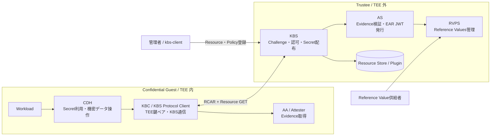
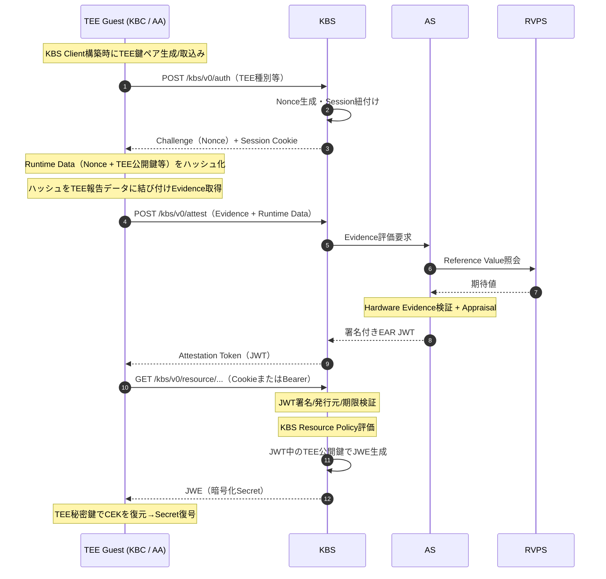
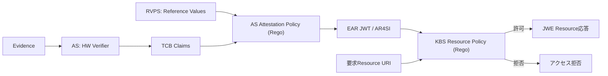
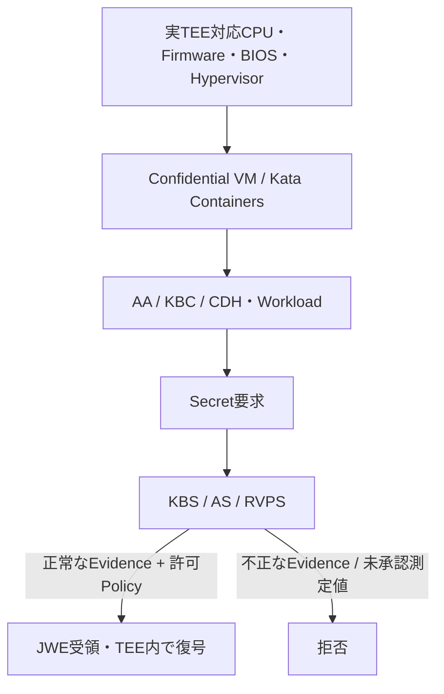

# Trustee 技術解説・構築検証レポート

**副題：アーキテクチャ・コンポーネント・処理フロー・TEE秘密鍵・Nonce・JWT/JWE・構築検証・用語集**  
**更新日：2026-10-19（JST）／版：1.0**  
**対象：Confidential Containers の Trustee を評価・構築するエンジニア**

> **参照の固定**：本書は `confidential-containers/trustee` のコミット `3e160008ef3e5d8ce82e59c729d56e2d0175dba0`（2026-10-16）と、`confidential-containers/guest-components` の `8709d40babf81b233402215ed0f0116b7dfa3516`（2026-10-16）を基準に作成した。参照コードは将来変更され得る。根拠文書は末尾にまとめた。
>
> **ステータス**：設計・検証計画としてのレポート。掲載コマンドは上流ドキュメント／Makefileを照合した例であり、この実行環境での実機実行結果ではない。

## 0. エグゼクティブサマリー

Trustee は、**TEE（Trusted Execution Environment）で動くゲストが正しく構成されていることを Remote Attestation で評価し、許可されたゲストにのみ Secret／Resource を提供する仕組み**である。Trustee自体がTEEを作るのではない。保護境界を提供するのはIntel TDX、AMD SEV-SNPなどのハードウェアと、それを利用する実行環境である。[S1][S2]

理解の要点は次の5点。

1. **KBS** が窓口・認可・Secret配布、**AS** がEvidence検証・結果発行、**RVPS** が期待測定値（Reference Value）を管理する。
2. **Nonce** は通常、TEE外のKBSが生成する。新鮮なChallengeをEvidenceに結び付け、過去のEvidenceの再利用を検出する。
3. Secret用**TEE鍵ペア**は通常、TEEゲスト内のクライアントがソフトウェア生成し、秘密鍵をゲストのプロセスメモリに保持する。CPU固有の非エクスポート鍵と同じではない。
4. **JWT（署名付きAttestation Token）** が「何を検証したか」をKBSに伝え、**JWE（暗号化Resource）** が「Secretの秘匿」を担う。署名と暗号化は別機能である。
5. **Docker Compose／Sample Attesterでの疎通成功 ≠ 実TEEの保護確認**。PoCは制御面の疎通と、実TEEのAttestationを別フェーズで検証する。

## 1. 対象・前提・信頼境界

### 1.1 対象範囲

- Trustee本体：KBS、AS、RVPS、KBS管理用CLI、Resource Policy、Attestation Policy、リソース配布。
- Guest Components：AA（Attestation Agent）、CDH（Confidential Data Hub）、KBC（Key Broker Client）／KBS Protocol Client、TEE固有Attester。
- 検証：ローカルDocker Compose、Kubernetes Helm、実TEEでのEvidence、正常・異常系、運用上の留意点。

### 1.2 どこが信頼され、何が保護されるか

| 領域 | 構成要素 | 主要な責任／保護特性 |
|---|---|---|
| TEEゲスト内 | AA、KBC、CDH、アプリケーション | Evidence取得、TEE鍵ペア生成／保持、JWE復号、Secret利用 |
| TEE外の信頼サービス | KBS、AS、RVPS | Evidenceを検証しポリシー判断、Secretを条件付き配布 |
| 実行基盤 | CPU/ファームウェア/Hypervisor/Kata等 | TEE隔離、測定値、署名付きEvidenceの生成経路 |
| 管理・サプライチェーン | 管理者、イメージ供給者、Reference Value供給元 | Resource／Policy／Reference Valueの正確性と信頼性 |

**重要な限界**：TEEは、すべてのゲスト内プロセス間を自動的に隔離する仕組みではない。ゲストOS・AA・KBC・アプリの権限と信頼性は引き続き問題になる。また、Attestationは設定されたポリシー・測定対象・信頼ルートの範囲内でしか安全性を評価できない。

## 2. コンポーネント構成と役割



| 略称 | 正式名称 | 主な役割 | 実装上の注目点 |
|---|---|---|---|
| KBS | Key Broker Service | KBCとの通信窓口、Challenge/Session、Attestation要求の仲介、JWT検証、Resource Policy、JWE応答 | `kbs/`、`kbs/docs/kbs_attestation_protocol.md` |
| AS | Attestation Service | ハードウェアEvidenceをTEE別Verifierで検証、TCB Claimを評価、署名付きEAR JWTを発行 | `attestation-service/`、`docs/policy.md` |
| RVPS | Reference Value Provider Service | 期待測定値・参照値の受領、抽出、保管、ASへの提供 | `rvps/`、Extractorの署名検証範囲 |
| AA | Attestation Agent | ゲスト内でTEE Evidence／Attestation Tokenの取得を支援 | `guest-components/attestation-agent/` |
| KBC | Key Broker Client | RCAR通信、TEE鍵ペア保持、Resource取得・復号 | `guest-components/attestation-agent/kbs_protocol/` |
| CDH | Confidential Data Hub | ゲスト内アプリ等への機密データ・鍵・保護データ操作の提供 | `guest-components/confidential-data-hub/` |
| Resource Plugin | KBS Resource提供プラグイン | 登録済みResource、外部KMS/HSM等からデータを取得 | Resource Policy判定後の提供元 |
| kbs-client | Trusteeの管理・テストCLI | Resource/Policy登録、Attestation/Secret取得のPoC | `tools/kbs-client/` |

**整理**：ASは「Evidenceをどう評価するか」、KBSは「評価結果を持つゲストにどのResourceを渡すか」を決める。RVPSはASの参照データを管理する。[S2][S3]

## 3. エンドツーエンド処理フロー

### 3.1 RCAR（Request → Challenge → Attestation → Response）からResource配布まで



**通信補足**：Cookie方式とBearer JWT方式があり、KBSはいずれもリソース取得時にTokenを検証する。KBSが暗号化Resourceを返す場合はJWTからTEE公開鍵を抽出する。JWTを使った認証だけでSecretの機密性を保証するわけではない。[S4][S5]

### 3.2 Evidenceの検証とは

| 検証項目 | 何を確認するか | 代表的な失敗例 |
|---|---|---|
| Evidenceの真正性 | TEEハードウェアの署名・証明書チェーン・TEE種別固有の正当性 | 偽造したEvidence |
| Freshness | 今回KBSが発行したNonceが報告データと結び付いているか | 古いEvidenceの再送 |
| 公開鍵バインディング | AttestationされたRuntime Data内の公開鍵と報告データのハッシュが一致するか | 別の公開鍵への差し替え |
| TCB／測定値 | Firmware、初期測定値、起動構成、ランタイム状態等が期待どおりか | 未承認イメージ、脆弱なTCB |
| Policy | AS側の評価条件とKBS側の配布条件を満たすか | Evidenceが有効でも対象Resourceの権限なし |

**注**：公開鍵をEvidenceに結び付けることは、公開鍵に対応する秘密鍵がハードウェア内の「非エクスポート可能スロット」に存在することの証明ではない。コードが秘密鍵をソフトウェアで生成／取込み可能である以上、保護の前提は測定・信頼したゲストスタックの挙動に依存する。

## 4. これまでの質疑を踏まえた技術解説

### Q1. TEE公開鍵に対応する秘密鍵は、どのように取得・保持されるか？

**回答**：通常、KBSクライアントの構築時に**TEEゲスト内で新しい鍵ペアを生成**し、`KbsClient.tee_key` に保持する。標準の秘密鍵はTEEハードウェアの固有秘密鍵ではなく、**ゲストのプロセスメモリ上に存在する暗号鍵**である。デフォルトの鍵方式は楕円曲線P-256／ECDH-ES+A256KW。[S6]

```rust
// guest-components: attestation-agent/kbs_protocol/src/builder.rs の要点
let tee_key = match self.tee_key {
    Some(key) => TeeKeyPair::from_pem(&key)?, // 指定されたPEM秘密鍵を取込むことも可能
    None => TeeKeyPair::new_with_algorithm(self.tee_key_algorithm)?,
};
```

秘密鍵の寿命はKBS Client／鍵オブジェクトの寿命に依存し、再Attestationのたびに必ず再生成する仕様ではない。クライアント再生成時には新しい鍵になるのが通常であり、永続化を特に設計しなければ再起動で失われる。

**重要な例外（Passport）**：AAから別のゲスト内コンポーネントへ、トークンと秘密鍵を**PEMとしてシリアライズして受け渡す実装**がある。`attestation-agent/src/token/kbs.rs` の `tee_keypair.to_pem()` と `kbs_protocol/src/token_provider/aa/mod.rs` の再取込みが根拠となる。したがって「秘密鍵はあらゆる条件でAAプロセスから外へ出ない」とは言えない。[S7]

**JWE復号**：KBSがTEE公開鍵を使ってSecret暗号化用のCEKを包み、TEE側は秘密鍵でCEKを復元し、`A256GCM`でSecretを復号する。[S6]

**安全性の前提**：TEE外のホスト／VMMからゲストメモリを直接読めないことと、ゲスト内特権プロセスが秘密鍵へアクセスできないことは別の話。OS・AA・KBCの測定、権限、ログ、IPC、PEM出力をレビューする。

### Q2. Nonceとは何か。TEEの外で生成されるのか？

**回答**：Nonceは**そのAttestationチャレンジのための使い捨て乱数**。通常、TEE外の**KBS**が発行する。Trusteeの一般経路では`OsRng`で**32バイト（256ビット）**を生成し、Base64にして送信する。[S8]

```rust
// trustee: kbs/src/attestation/backend.rs
const NONCE_SIZE_BYTES: usize = 32;
let mut nonce = vec![0; NONCE_SIZE_BYTES];
OsRng.fill_bytes(&mut nonce[..]);
let nonce_base64 = STANDARD.encode(&nonce);
```

KBCはこのNonceとTEE公開鍵等をRuntime Dataに含め、正規化したJSONのハッシュをTEEのReport Dataへ渡してEvidenceを得る。KBS／ASの検証で現在のChallengeと整合していなければ拒否される。**Nonceの役割はFreshnessであり、機密情報ではない。**[S4][S9]

**例外**：IBM Secure Execution向けChallenge生成ではAS側の専用経路が使われる。あらゆるTEEで常にKBSが単独で乱数を作るわけではない。[S8]

### Q3. JWTとは何か。Trusteeのどこで使うのか？

**回答**：JWT（JSON Web Token）は、Claim（主張・属性情報）をJSONで表現するトークン形式。Trusteeでは**ASがTEEの検証結果を署名付きJWTとして発行**し、KBSがResource配布の際に検証・利用する。ASのAttestation Tokenは**EAR（EAT Attestation Result）**形式のClaimを含み、端末やデバイス別の`submods`、AR4SIの信頼評価結果などが含まれる。[S5][S10]

```text
JWT（署名付きの場合 / JWS）
base64url(Header) . base64url(Payload) . base64url(Signature)
       └ 署名方式        └ Claim・有効期限等       └ 改ざん検証
```

JWTのPayloadは通常**暗号化されず読み取れる**。受領しただけで信用せず、署名、信頼する発行者／署名鍵、期限、期待するClaimを検証する。現行TrusteeではKBSが署名鍵と必要に応じて証明書チェーンを検証する。`trusted_certs_paths` を適切に設定し、`insecure_header_jwk=true` は本番利用しない。[S5]

**混同してはいけない鍵**：

| 鍵 | 保有者 | 用途 |
|---|---|---|
| TEE Secret復号用秘密鍵 | TEE内KBC等 | JWEのCEK復元／Secret復号 |
| ASのAttestation Token署名鍵 | AS | TEE検証結果JWTへの署名 |
| KBS管理API用の管理者署名鍵 | 管理者／認証基盤 | 管理者JWTでKBS設定APIを保護 |
| TEEハードウェアAttestation鍵／証明書 | ハードウェア／プラットフォーム | Quote／Reportの真正性を証明 |

### Q4. JWTとJWE、TLSの違いは？

| 技術 | 主な目的 | Trusteeでの利用 |
|---|---|---|
| JWT + JWS署名 | 検証結果／Claimの完全性、発行者の検証 | ASがAttestation Tokenを発行しKBSが確認 |
| JWE | データの暗号化・復号 | KBSがTEE公開鍵に紐付けてSecretを暗号化して応答 |
| HTTPS/TLS | 通信経路の盗聴・改ざん防止、サーバ認証 | KBC↔KBS等の通信保護 |
| Nonce | Freshness・再利用防止 | KBS ChallengeからTEE Evidenceへ紐付け |

相互に代替できない。TLS通信だけでは受領側の実行環境をAttestationしたことにはならず、JWT署名だけではSecretの内容は秘匿されない。**JWTが認可判断を支え、JWEが配布先に対応する暗号学的保護を提供する**と捉えると理解しやすい。

### Q5. 「Evidenceが正しい」ならSecretは必ず配布されるのか？

**いいえ。** Evidenceの真正性と、測定値・TCBの妥当性をASが評価したあと、**KBS Resource Policyが要求Resourceへのアクセスを別に認可**する。AS側のAttestation PolicyはEARの信頼評価を構築し、KBS側のResource PolicyはURIとToken内容を材料に配布可否を決める。[S2][S11]

### Q6. RVPSのReference Valueは信用できるのか？

RVPSは期待測定値を保持し、ASに提供するが、**登録された値の出所をどこまで検証するかはExtractorおよび運用プロセス次第**。上流READMEによれば、Sample Extractorは署名検証を行わず、SWID/RIM ExtractorもManifestの署名検証を自動では行わない。高信頼構成ではRVPS投入前の署名検証、承認、更新管理が必要。[S12]

## 5. ポリシーと認可の整理



| 制御 | 入力 | 出力 | 運用上の責任 |
|---|---|---|---|
| AS Attestation Policy | 検証済みTCB Claim、RVPS参照値等 | EARの信頼評価・拡張Claim | 何を「期待した状態」とするか |
| KBS Resource Policy | EAR JWT、Resource URI、リクエスト情報 | Resourceごとの許可／拒否 | どの状態のGuestに何を渡すか |
| KBS Admin AuthN/AuthZ | 管理者JWT、`role`、API経路 | 管理操作の許可／拒否 | Secret登録・Policy変更の権限 |

管理者JWTには設定に応じた認証と`role` Claimが要求され、Resource取得のためのAttestation JWTとは用途が異なる。[S13]

## 6. 構築・検証プラン（推奨順）

### フェーズA：Docker Composeで制御面の疎通確認（実TEE保証なし）

**目的**：KBS/AS/RVPS起動、管理API、Secret登録、標準拒否、許可時のSecret配布と復号を理解する。Linux上のDocker Engine／ComposeとRustツールチェーンが前提。以下はTrusteeの**検証専用**構成。[S14]

```bash
# 1. 参照リビジョン固定
git clone https://github.com/confidential-containers/trustee.git
cd trustee
git checkout 3e160008ef3e5d8ce82e59c729d56e2d0175dba0

# 2. サービスを起動
docker compose up -d
docker compose ps

# 3. Sample Attesterに絞ってCLIをビルド
make -C kbs cli CLI_FEATURES=sample_only

# 4. ダミーSecretを登録（本番の秘密情報は使わない）
printf 'trustee-poc-demo-secret\n' > /tmp/trustee-demo-secret
./target/release/kbs-client --url http://127.0.0.1:8080 \
  config --admin-token-file kbs/config/docker-compose/admin-token \
  set-resource --path demo/app/key1 \
  --resource-file /tmp/trustee-demo-secret

# 5. まず試す：Sample Evidenceは標準では拒否される
./target/release/kbs-client --url http://127.0.0.1:8080 \
  get-resource --path demo/app/key1

# 6. ローカル疎通検証のみ：一時的に全許可ポリシーへ変更
./target/release/kbs-client --url http://127.0.0.1:8080 \
  config --admin-token-file kbs/config/docker-compose/admin-token \
  set-resource-policy --allow-all

# 7. 再取得：疎通とJWE復号を確認
./target/release/kbs-client --url http://127.0.0.1:8080 \
  get-resource --path demo/app/key1
```

**期待結果**：手順5でSample Evidenceが拒否されること、手順7で登録済みダミーSecretを取得・復号できること。後者は**実TEEのAttestation成功を意味しない**。`--allow-all` はPoC終了後に必ず解除し、受け入れ条件として厳格なPolicyへ置き換える。[S14]

**観測ポイント**：`docker compose logs kbs`（Composeの実際のサービス名は`docker compose ps`で確認）、KBS `/metrics`、HTTPステータス、AS/RVPSのログ、失敗理由。Admin TokenとAS署名鍵はComposeのセットアップ処理で生成され、開発用のローカルファイルとして管理される。[S14][S15]

### フェーズB：KubernetesにTrusteeをデプロイ

**目的**：KBS/AS/RVPSをKubernetesに配備して疎通・設定・運用要件を確認する。上流Helm ChartはKubernetes 1.19+とHelm 3を要する。[S16]

```bash
# リポジトリのルートディレクトリで実行
helm dependency update ./deployment/helm-chart
helm upgrade --install trustee ./deployment/helm-chart \
  --namespace coco-trustee --create-namespace

kubectl get deploy,pods,svc -n coco-trustee
helm status trustee -n coco-trustee

# 別ターミナルでKBSへ接続
kubectl port-forward -n coco-trustee svc/trustee-kbs 8080:8080
```

**デフォルト値を本番構成と解釈しない**。Helmの標準例ではKBSがHTTP 8080、セッションがMemory、キー生成が一時的なブートストラップ設定であり、Resource/RVPSのLocalFs等の永続化、CA/署名鍵管理、TLS、可用性、NetworkPolicyは要設計。PostgreSQL・Valkeyの利用オプションが提供される。[S16]

### フェーズC：本物のTEEでEnd-to-End Remote Attestation

**目的**：Intel TDXまたはAMD SEV-SNPなど、実際のConfidential GuestからEvidenceを取得し、Trusteeが「許可された測定値だけ」にSecretを配布することを確認する。



対象TEEは実機環境に応じて確定する。KubernetesにTrusteeをインストールするだけではGuestがTEEになるわけではない。別途、Confidential VM Runtime／Attester動作／見込むReference Valueを整備する。[S1][S2]

### フェーズD：セキュリティと運用の確認

- Admin APIの認証・認可（`role`・ACL）を最小権限化し、Tokenの発行鍵と配布経路を保護する。
- AS署名鍵／証明書チェーンを適切に維持し、KBSの`trusted_certs_paths`によって信頼できるAS Tokenのみ認める。[S5][S13]
- `--allow-all`／`insecure_header_jwk=true`／無条件のSample Evidence許可を本番から排除する。
- TLS、秘密情報の保存先、永続化、バックアップ、ログ中のSecret混入、Resourceの失効・更新を設計する。
- RVPSに登録するReference Valueの出所・署名・承認・更新のワークフローを検証する。[S12]
- 複数Pod／再起動時のSession共有、Key更新、Policy配布、外部KMS連携の実現性を確認する。

## 7. テストケースと合格条件

| ID | テスト | 期待結果 | Phase |
|---|---|---|---|
| T01 | KBS/AS/RVPS起動 | Pod/ContainerがReady、ログ上の接続エラーなし | A/B |
| T02 | Resource登録 → 読出し | 許可されたSample構成でダミーSecretが一致 | A |
| T03 | 標準のSample Evidence拒否 | 許可前にはSecretが配布されない | A |
| T04 | JWT改ざん | 署名検証で拒否 | B/C |
| T05 | 期限切れJWT | Token再取得要求または拒否 | B/C |
| T06 | 不正Nonce／旧Evidence再送 | Attestation拒否 | C |
| T07 | TEE公開鍵とEvidenceの紐付け不一致 | Attestation拒否 | C |
| T08 | 測定値を変更したGuest | AS評価／KBS Policyに応じSecret拒否 | C |
| T09 | 有効なEvidenceだがResource Policy違反 | Secret配布拒否 | C |
| T10 | 別のTEE秘密鍵でJWE復号 | 復号失敗 | C |
| T11 | Resource不存在 | 404 Not Found（現行のPlugin NotFound経路） | A/B |
| T12 | 管理者権限のないPolicy変更 | Admin API拒否 | B/D |
| T13 | 再起動・複数Pod | Session/鍵/Resourceの意図した継続・再認証が成立 | D |
| T14 | Resource／JWT／ポリシーの監査 | 秘密情報をログに露出せず、拒否・許可を観測可能 | D |

**評価時の記録項目**：TEE種別・Firmware/TCB・測定値・Evidenceタイプ・Policy ID・Reference Value・Token Claims・HTTPステータス・ログ参照・リソースURI・構成リビジョンを、各テストごとに保存する。テストレポート中に秘密鍵・本番Secret・Bearer Tokenの平文を残さない。

## 8. 運用・設計上の重要事項

### 8.1 キー・Token・Nonceのライフサイクル

| 対象 | 作成／保持 | 失効・更新／注意 |
|---|---|---|
| KBCのTEE秘密鍵 | KBC構築時に通常生成しメモリ保持。設定でPEM取込みも可能 | 再起動やプロセス再生成で喪失し得る。Tokenと公開鍵の対応維持が必要 |
| Nonce | 通常KBSが32バイト乱数生成 | 1つのChallengeに紐付け。旧値の再利用を認可しない |
| AS署名鍵 | AS側の管理鍵 | Token署名・証明書チェーン、KBS側Trust Anchor管理が必要 |
| Attestation JWT | Evidence評価後にAS発行 | 署名・発行元・有効期限を検証。短命・更新設計が必要 |
| Resource Secret | KBS Plugin／外部KMS等 | バージョン管理、配布元ACL、失効・ローテーション、ログの秘匿 |
| RVPS Reference Value | 供給者から登録・保持 | 改ざん・古い値・供給元なりすましの対策が必要 |

### 8.2 チーム内で明文化したい設計判断

| 設計判断 | 推奨する検討軸 |
|---|---|
| TEE種別 | TDX / SNP / その他。CPU・Firmware・Quote取得・クラウド依存性 |
| Attestation条件 | AS PolicyがどのClaim/Reference Valueを基準にするか |
| Resource Policy | Workload識別、Secret単位の条件、デフォルト拒否 |
| Resource Backend | LocalFs、外部KMS/HSM、バックアップ、障害・権限境界 |
| Token信頼 | AS署名鍵、CAチェーン、期限、Passport／Background Check |
| KBC秘密鍵の扱い | メモリ上のみか、PEM受け渡しがあるか、プロセス間の権限境界 |
| Kubernetes運用 | TLS・StorageClass・永続化・Session共有・可用性・監視 |
| 変更管理 | Trustee / guest-componentsのコミット固定、イメージDigest、Policyの変更履歴 |

## 9. 用語集（Glossary）

| 用語 | 正式名称／説明 | 本書での意味 |
|---|---|---|
| Confidential Computing | 機密計算 | 実行中のデータをTEE等で保護する考え方 |
| TEE | Trusted Execution Environment | 保護された実行環境。メモリの隔離・Attestation等の基盤 |
| Confidential VM | Confidential Virtual Machine | VM単位でTEE保護される実行形態 |
| Confidential Containers / CoCo | Confidential Containers | Kubernetes／Kata等で機密コンテナを動かすプロジェクト |
| Trustee | — | Remote Attestation＋条件付きSecret配布のサービス群 |
| KBS | Key Broker Service | Challenge、認可、Resource配布の窓口 |
| AS | Attestation Service | Evidence検証・評価とAttestation Token発行 |
| RVPS | Reference Value Provider Service | 期待値／参照測定値の登録・提供 |
| AA | Attestation Agent | ゲストでEvidence／Tokenを取得するエージェント |
| KBC | Key Broker Client | KBSとのAttestation／Resource取得クライアント |
| CDH | Confidential Data Hub | ゲスト内の機密情報を扱うサービス |
| Remote Attestation | リモート構成証明 | 第三者（検証者）が実行環境の状態をEvidenceで確認する仕組み |
| Evidence | 証拠データ | TEEハードウェアが保護する署名・測定値等を含む証拠 |
| Attester | 証拠生成主体 | Evidenceを取得・生成するTEE側の機能 |
| Verifier | 検証主体 | Evidenceの真正性・TCB状態を検証するAS等 |
| Relying Party | 検証結果利用主体 | Attestation結果をもとにアクセス許可を決めるKBS等 |
| TCB | Trusted Computing Base | 信頼する必要があるハードウェア／ソフトウェア要素の集合 |
| Measurement | 測定値 | コードや起動状態等を表すハッシュ・計測値 |
| Reference Value | 期待値／参照値 | Measurementの照合基準としてRVPSが管理する値 |
| Endorsement | 裏付け証明 | ハードウェアの鍵・プラットフォーム情報等の信頼根拠 |
| Nonce | Number used once | 今回のChallengeに対するFreshness確保用の乱数 |
| Freshness | 鮮度 | 提示されたEvidenceが過去の再生ではなく今回の要求に対応する性質 |
| Replay Attack | リプレイ攻撃 | 過去に有効だったメッセージを再送して不正に認証を得る攻撃 |
| Runtime Data / Report Data | 実行時データ／TEE報告データ | Nonce・公開鍵等をTEE Evidenceに暗号学的に結び付ける入力 |
| Quote / Report | TEE証明レポート | TDX/SNP等のハードウェア固有Evidence |
| RCAR | Request-Challenge-Attestation-Response | Trustee KBSのAttestationハンドシェイク |
| JWT | JSON Web Token | JSON Claimを表すToken形式。Trusteeでは署名付きAttestation結果で利用 |
| JWS | JSON Web Signature | Token等への署名・改ざん検出の仕組み |
| JWE | JSON Web Encryption | Secretを暗号化して配布するための仕組み |
| Claim | 主張／属性 | JWT等に記載する状態、評価結果、識別情報 |
| EAR | EAT Attestation Result | ASが発行する標準化されたAttestation結果の表現 |
| AR4SI | Attestation Results for Secure Interactions | 信頼状態をベクトル等で示す評価モデル |
| submods | Submodules | EAR内でCPU/GPUなどのデバイスごとの評価を表す構造 |
| CEK | Content Encryption Key | JWE内でSecret本体を共通鍵暗号化する鍵 |
| ECDH | Elliptic Curve Diffie-Hellman | 楕円曲線による共有鍵導出に利用する方式 |
| P-256 | 楕円曲線の一種 | 標準のTEE鍵で使う曲線 |
| AES-256-GCM | 認証付き共通鍵暗号 | Trustee JWEのSecret本体の暗号化方式 |
| OPA / Rego | Open Policy Agent / Rego | Attestation PolicyとResource Policyの評価に使う言語・エンジン |
| Resource | 配布対象データ | 鍵、証明書、トークン、機密設定など |
| Resource Policy | KBS認可ポリシー | どの状態のGuestにどのResourceを許可するか |
| Attestation Policy | AS評価ポリシー | どのMeasurement/TCB Claimをどう評価するか |
| Passport Mode | 分離されたToken利用方式 | Attestation取得とResource要求を分離してJWTを持ち回る方式 |
| Background Check | 連携したAttestation方式 | KBS経由でRCARを行いSession等を利用する方式 |
| LocalFs | ローカルファイルシステム格納 | テスト時に簡単だが永続性・分散・秘密管理に注意 |
| Trust Anchor | 信頼の起点 | AS署名証明書等を検証する基準となるCA／鍵 |

## 10. 参考情報・検証根拠

### 10.1 ソースリビジョン

- Trustee：[`3e160008ef3e5d8ce82e59c729d56e2d0175dba0`](https://github.com/confidential-containers/trustee/commit/3e160008ef3e5d8ce82e59c729d56e2d0175dba0)
- guest-components：[`8709d40babf81b233402215ed0f0116b7dfa3516`](https://github.com/confidential-containers/guest-components/commit/8709d40babf81b233402215ed0f0116b7dfa3516)

### 10.2 公式ドキュメント・実装

- **[S1]** [Trustee README](https://github.com/confidential-containers/trustee/blob/main/README.md) — 全体像、サービス、デプロイ方式
- **[S2]** [Confidential Containers: Architecture](https://confidentialcontainers.org/docs/attestation/architecture/) — KBS/AS/RVPSとポリシーの責任分界
- **[S3]** [Confidential Containers: Attestation with Trustee](https://confidentialcontainers.org/docs/attestation/) — Guest Components構成
- **[S4]** [KBS Attestation Protocol](https://github.com/confidential-containers/trustee/blob/main/kbs/docs/kbs_attestation_protocol.md) — RCAR、Nonce、Resource、JWE
- **[S5]** [Attestation Token Verification](https://github.com/confidential-containers/trustee/blob/main/kbs/docs/attestation_token_verification.md) — JWT検証、CookieとBearer、信頼CA
- **[S6]** [KBS Protocol TeeKeyPair](https://github.com/confidential-containers/guest-components/blob/main/attestation-agent/kbs_protocol/src/keypair.rs)、[KBS Client Builder](https://github.com/confidential-containers/guest-components/blob/main/attestation-agent/kbs_protocol/src/builder.rs)、[ECDH実装](https://github.com/confidential-containers/guest-components/blob/main/attestation-agent/deps/crypto/src/native/ec.rs) — TEE鍵生成・保持・JWE復号
- **[S7]** [AA KBS Token Getter](https://github.com/confidential-containers/guest-components/blob/main/attestation-agent/attestation-agent/src/token/kbs.rs)、[AA Token Provider](https://github.com/confidential-containers/guest-components/blob/main/attestation-agent/kbs_protocol/src/token_provider/aa/mod.rs) — Passport方式でのPEM受け渡し
- **[S8]** [KBS Attestation backend](https://github.com/confidential-containers/trustee/blob/main/kbs/src/attestation/backend.rs)、[KBS CoCo gRPC backend](https://github.com/confidential-containers/trustee/blob/main/kbs/src/attestation/coco/grpc.rs) — 32B NonceとSecure Execution例外
- **[S9]** [KBC RCAR実装](https://github.com/confidential-containers/guest-components/blob/main/attestation-agent/kbs_protocol/src/client/rcar_client.rs) — Runtime Data、Nonceと公開鍵のハッシュバインディング
- **[S10]** [Attestation Token / EAR](https://github.com/confidential-containers/trustee/blob/main/attestation-service/docs/attestation_token.md) — submods等のAttestation Claim
- **[S11]** [AS Attestation Policy](https://github.com/confidential-containers/trustee/blob/main/attestation-service/docs/policy.md) — Rego、AR4SI、Device Policy
- **[S12]** [RVPS README](https://github.com/confidential-containers/trustee/blob/main/rvps/README.md) — Reference Value、Extractor、署名検証の注意点
- **[S13]** [KBS Admin Module](https://github.com/confidential-containers/trustee/blob/main/kbs/docs/admin.md) — Admin JWT、`role`、ACL
- **[S14]** [KBS Cluster / Docker Compose](https://github.com/confidential-containers/trustee/blob/main/kbs/docs/cluster.md)、[Quickstart](https://github.com/confidential-containers/trustee/blob/main/kbs/quickstart.md) — Compose／PoC
- **[S15]** [KBS Prometheus Metrics](https://github.com/confidential-containers/trustee/blob/main/kbs/docs/metrics.md) — 監視
- **[S16]** [Trustee Helm Chart](https://github.com/confidential-containers/trustee/blob/main/deployment/helm-chart/README.md) — K8s構築、Storage、鍵・Session
- **[標準]** [RFC 7519 — JWT](https://www.rfc-editor.org/rfc/rfc7519)、[RFC 7516 — JWE](https://www.rfc-editor.org/rfc/rfc7516)、[RFC 7515 — JWS](https://www.rfc-editor.org/rfc/rfc7515)

## 11. 次の検証に向けた残課題

- **環境依存で未確定**：検証対象TEE（TDX / SEV-SNP / その他）、CPU/BIOS/Firmware、ゲスト起動方式、Kubernetes RuntimeClass、実際のQuote取得経路。
- **ポリシー設計**：どの測定値をTrust条件とするか、Reference Value登録・署名検証を誰が担うか。
- **鍵管理**：AAとKBCのIPC／PEM受け渡しを採用するか、ゲスト内アクセス境界とSecretの使用先をどう制限するか。
- **運用設計**：AS署名鍵、管理者JWT、KBS Token検証CA、永続化、TLS、バックアップ、監視。
- **成果物**：PoCの実行記録（入力条件、期待値、結果、失敗時ログ）を別ファイルで蓄積すること。

---

**更新規約**：ソースコミット・確認日・再現環境・変更内容を記録して改訂する。コード例は参考実装であり、実機検証の結果と混同しない。Markdown（Mermaid＋相対セクション参照）はGitHubレビューとナレッジの継続更新に向いており、本ファイルを一次資料、PPTXを必要時の説明用派生資料とする。
