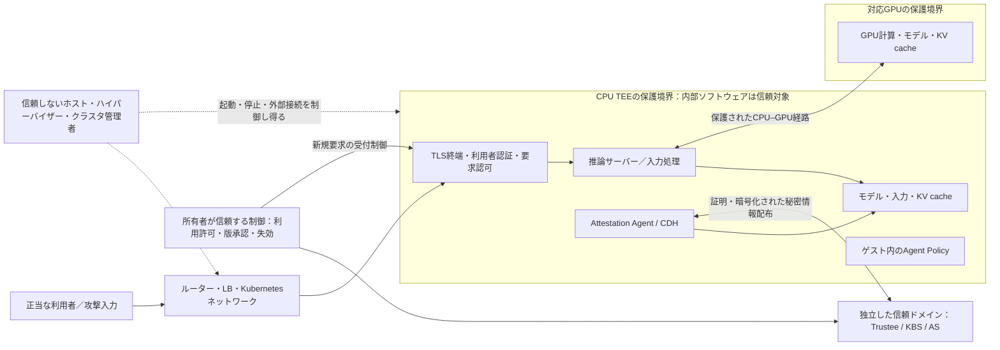
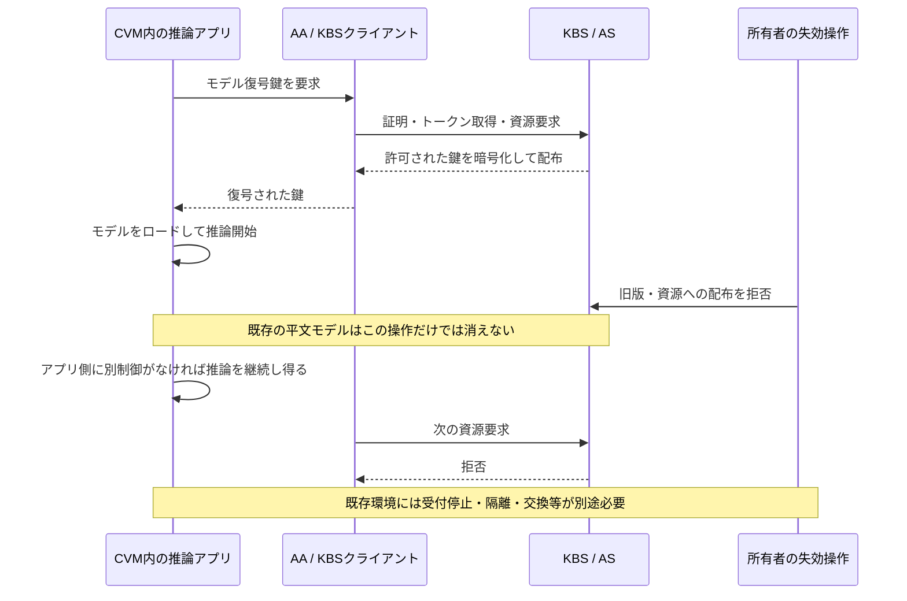
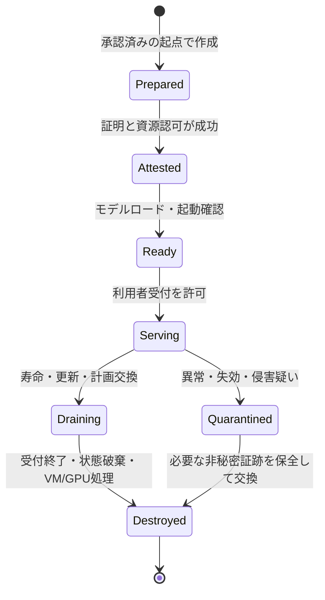

# 常駐型TEEで推論を提供する場合のリスクと対応

- 調査・一次ソース確認日：**2026年10月21日（JST）**
- 対象：既存コンテナ、データ分析、AI推論をCPUのConfidential VM（CVM）で保護し、必要に応じてConfidential Computing対応GPUを接続する構成。
- 主な参照対象：Confidential Containers（CoCo）、Kata Containers、Trustee、guest-components、vLLM、NVIDIA公式設計資料。
- 調査方法：公式文書と公開実装の読解。**実機TEEでの侵入試験、メモリ消去試験、性能測定は実施していない。** 本文の検証項目は今後の受入試験案である。
- 関連：[CoCo全体構成](../../../projects/confidential-containers/reports/confidential-containers-system-architecture-2026-10-19.md)、[Trustee・Attestation調査](../../../projects/trustee/reports/trustee-architecture-attestation-poc-report-2026-10-19.md)。

## 1. 結論

**「攻撃できる入口を公開し、秘密情報を保持したTEEを長期間動かすと、短命なCVMよりリスクが増える要因がある」という懸念は妥当である。** 特に、推論APIや依存ライブラリの侵害、テナント間の状態共有、侵害後の滞在、古いソフトウェアの継続利用が問題になる。ただし、起動時間の長さだけから危険度を決めることはできない。同じリクエストを何度も処理する短命CVMにも、アプリケーションの脆弱性や出力経由の漏えいは残る。

TEEは、信頼しないホストやハイパーバイザーからゲストの処理・メモリを保護するための境界を提供する。**TEE内の推論サーバーを侵害した攻撃者に対して、モデル・入力・鍵が自動的に保護されるわけではない。** 信頼するゲストOS、エージェント、推論ランタイム、ポリシーの範囲を小さくし、その内部の侵害にも備える必要がある。[C1]・[N1]

推論サービスでは、モデルロードの費用と初回応答時間を考えると、常駐自体を避けるより、次の設計を検討する価値がある。これは本調査による設計提案であり、CoCoが自動的に提供する一式の機能ではない。

1. **信頼ドメインを分け、寿命を区切って交換する。** テナント、モデル所有者、データ機密区分に応じてCVMを分離し、承認済みイメージから定期的・事象発生時に再作成する。
2. **VMの寿命と秘密情報の寿命を分ける。** 常駐するモデルと、要求ごとの入力・KV cache・一時資格情報を同じ保持期間にしない。
3. **再証明、鍵配布停止、稼働停止を別の制御として実装する。** 新しいAttestationが通っても無侵害の証明にはならず、KBSの配布停止だけでは既存CVMの平文モデルは消えない。
4. **重要な認証・認可を信頼境界内で強制する。** クラスタ管理者を脅威に含めるなら、その管理者が変更できる外側のゲートウェイやNetworkPolicyだけに依存しない。

## 2. 「常駐」と「短命」を何で比較するか

### 2.1 起動方式と保護方式は別の軸

常駐型TEEは、別種の暗号技術を意味しない。同じCVMを「1要求ごと」「セッション・バッチごと」「数時間・数日ごとの交換」「継続稼働」のいずれで運用するかというライフサイクルの選択である。PeerPodsかローカルPodVMかも配置の軸であり、常駐による状態保持の問題はどちらにも生じ得る。

「停止」も区別する。プロセス再起動、Pod再起動、CVM破棄、GPUリセット、スナップショット復元は同じ状態初期化ではない。短命方式の効果を得るには、承認済みの変更不能な起点から再作成し、前回のメモリ・KV cache・不正な永続状態を持ち越さない条件が必要である。暗号化ディスクを使うだけでは、古い状態への巻き戻しまで防げるとは限らない。[C4]・[N2]・[N5]

### 2.2 比較に使う五つの量

| 観点 | リスクとの関係 | 短命化で期待できる効果と条件 |
|---|---|---|
| 攻撃入口が到達可能な時間 | 受信経路・管理経路に攻撃を試す機会がある | 利用外の到達時間は削減できる。稼働中の脆弱性自体は残る |
| 秘密情報が平文で存在する期間 | 侵害時に読めるデータ・鍵の範囲に関係する | 破棄・状態分離が実効的なら短縮できる。永続化や復元で持ち越すと効果が下がる |
| 侵害後の滞在可能時間 | 継続窃取、横展開、次の要求の観測に関係する | クリーンな交換で滞在を切れる可能性がある。外部資格情報や感染した共有データも対処する |
| 累積リクエスト数・入力の種類 | API悪用、モデル抽出、入力パーサーへの攻撃機会に関係する | 同数の要求を処理するなら、再起動だけで試行回数は減らない |
| 共有するテナント・モデル・権限 | 侵害時の被害範囲を決める | テナント単位の分離、最小権限、状態を共有しない設計が直接効く |

この五つは整理のための指標であり、単純に掛け算して漏えい確率を計算する式ではない。攻撃者の能力、脆弱性、入力数、パッチ水準をそろえない比較や、「稼働時間が2倍なら危険度も2倍」といった定量化は本調査では行わない。

### 2.3 懸念が強まる条件と弱まる条件

懸念が強まるのは、不特定多数に推論APIを公開する、管理・デバッグ入口が残る、複数顧客の状態を混在させる、モデルと強い外部資格情報を保持し続ける、更新せず常駐させる、といった条件である。

一方、入口が限定された専用テナントの処理、測定対象に含めた認証・認可、要求単位の状態分離、短期資格情報、承認済みイメージへの交換、秘密を含まない監査を備える場合、常駐のリスクを制御しやすくなる。暗号鍵が長時間動作するという理由だけで、TEEのメモリ保護が時間とともに弱くなると結論づける根拠は、今回確認した資料にはない。

## 3. 信頼境界と攻撃経路

以下は推奨する論理構成である。通信経路と信頼関係を示し、特定製品のネットワーク配線や、全機能が標準実装済みであることを意味しない。

CPU TEEの外にある通常のGPUへ平文を渡すなら、CPUメモリだけを保護しても推論全体の秘密性は成立しない。GPUの対応モード、証明、CPU–GPU経路、ドライバー等の信頼対象を確認する。[N1]・[N7]

入口を外部に公開しない構成でも、信頼しないホストから接続できるゲスト内サービス、モデル形式の読み込み、外部メディア取得、ゲストエージェントへの指示、共有ストレージは確認対象になる。Kata Agent Policyはホストからのゲスト操作を制限するための制御であり、推論APIの利用者認可とは役割が異なる。[C1]・[C5]・[V3]

| 境界・経路 | TEEで期待する保護 | 追加で設計する事項 |
|---|---|---|
| ホスト → ゲスト私有メモリ | 対象TEEの脅威モデルに従った分離・保護 | 証明ポリシー、TCB更新、デバッグ禁止、共有領域とI/Oの扱い |
| 利用者 → 推論API | 暗号化通信をゲスト内まで終端すれば平文経路を限定できる | 利用者認証、要求・テナントの認可、入力上限、出力制御 |
| 推論プロセス → 同じCVMの秘密 | ゲスト内部の侵害を自動的に防ぐ機能とはいえない | ゲストOS・ライブラリの縮小、権限分離、状態保持の最小化 |
| KBS → 秘密情報利用先 | 証明結果・資源ポリシーに基づく配布、受信鍵に対応する暗号化 | KBS/AS署名鍵の信頼、資源単位の認可、受信後の寿命 |
| テナントA → テナントB | 同じプロセス内のcache分離までは保証しない | CVM・プロセス・cacheの分離、所有者と要求IDの結合 |
| 監視・ログ・永続領域 | TEE外へ平文を書き出せば保護範囲を離れる | 秘密を記録しない運用、保存時暗号化、整合性・巻き戻し対策 |

管理者を信頼しない設計では、管理者が変更可能な入口のフィルターだけを最終防衛線にしない。ゲスト内の認証・認可、または所有者が独立して信頼するゲートウェイ等で強制する。ゲスト自体が侵害された後は、同じゲスト内のフィルターや監視も破られ得る。許可済みの応答経路からの流出もあり、外向き通信制限だけで解決しない。

## 4. 長期稼働で問題になる攻撃と対処

| 懸念 | 常駐との関係 | 主な対処 | 対処後も残る限界 |
|---|---|---|---|
| 推論API・入力処理の脆弱性 | 同じ環境に繰り返し入力でき、侵害後も次の入力を観測できる | 最小API、強い認証、入力サイズ・形式・取得先制限、依存更新 | 正当な入力や許可された出力を悪用する攻撃は別途評価 |
| 管理・内部通信の入口 | デバッグやクラスタ内部ポートが常時到達可能になる | 管理機能を除去、内部通信を分離、利用者経路と区別 | 外側の設定変更が可能な攻撃者にはゲスト側でも制御が必要 |
| テナント間のcache・残存状態 | 一つのプロセスが複数要求の状態を持ち続ける | テナント分離、KV cache再利用範囲の制限、保持上限 | 論理削除・cache分離は物理的な消去の証明ではない |
| 侵害の持続と被害拡大 | 常駐中の将来入力、保持モデル、外部資格情報へ影響が広がる | 寿命上限と交換、権限分離、資格情報短期化、検知時隔離 | 侵害中に持ち出されたモデルや平文は回収できない |
| パッチ・承認値の陳腐化 | 古いゲスト・ランタイム・TCBが使われ続ける | 版の棚卸し、変更承認、段階的交換、旧版配布拒否 | 再起動だけでは古いイメージを更新できない |
| ログ・ダンプ・一時ファイル | データが累積し、TEE外へ出る可能性がある | 本文を記録しない監視、ダンプ制限、保存期間と暗号化 | 障害調査で秘密を採取する運用例外に注意 |
| スナップショット・永続状態の再利用 | 秘密や侵害状態を交換後に持ち越し得る | クリーンな起点、状態の世代管理、復元ポリシー | 保存時暗号化だけでは鮮度・巻き戻し耐性を保証しない |
| 資源枯渇・ホストによる停止 | 長いセッションや巨大入力で資源を占有される | 認可単位の上限、タイムアウト、冗長化、性能監視 | ホストが停止・遅延させる可用性攻撃をTEEだけでは防げない |

CoCoのtrust modelは、保護する相手と信頼する内部コンポーネントを明示する。NVIDIAの推論設計も、最小イメージ、対話的管理の抑制、平文一時データの扱い、秘密を含まない監視、変更時の再承認を扱っている。これらは常駐サービスを成立させる設計上の根拠であり、個別システムが安全であるという実証結果ではない。[C1]・[N1]・[N2]・[N3]・[N4]

### 推論ランタイムの具体例：vLLM

確認したvLLMのセキュリティ文書では、APIキーの対象経路が限定されること、内部通信ポートを信頼するネットワークに隔離する必要、外部メディア取得・開発機能等の管理が説明されている。**APIキーを一つ設定したことを、全入口の認証完了と扱わない。** 使用する版・起動引数・公開経路を実際に照合する。[V3]

また、共有prefix cacheは応答時間による情報推測の対象になり得る。vLLMはCVE-2025-46570への対応として、推測困難な`cache_salt`でcache再利用の範囲を分ける仕組みを記述している。テナントごとに適切に設定することを検討するが、saltはメモリ消去や、侵害された推論プロセスからの隔離を提供しない。マルチモーダルcacheの識別子もテナントをまたいで不適切に共有しない。[V1]・[V3]

この例は、CPU/GPUのメモリをホストから守っていても、サービス内部の共有状態や応答時間まで自動的に安全になるわけではないことを示す。

## 5. 再証明と鍵の寿命を混同しない

### 5.1 五つの寿命を個別に管理する

| 対象 | 寿命・更新で制御するもの | それだけでは起きないこと |
|---|---|---|
| Attestation結果・トークン | 有効期限、許可するTCB・測定値、再取得条件 | 既存ゲストの全メモリ検査、既配布秘密の回収 |
| KBSが配るDEK・外部資格情報 | 新規配布、鍵の版、資源アクセス、資格情報の失効 | 平文として配られたDEKの自動消去。DEKのバイト列自体に期限はない |
| 平文モデル・入力・KV cache | ロード・再利用・破棄の期間と範囲 | 元のDEKを失効させるだけで、ロード済み平文を読めなくすること |
| 推論APIの利用者セッション | 誰がいつ何を要求できるか | Attestationだけで利用者の権限を証明すること |
| CVM・GPUコンテキスト | 実行状態の作成・交換・破棄 | Pod名の変更だけでCVMやGPUの全状態が破棄されたと確認すること |

### 5.2 現行実装で確認できたこと

TrusteeのKBS APIでは、資源要求に対してトークン検証と資源ポリシー評価を行い、許可された資源を返す経路を確認した。署名・有効性や発行者の信頼を適切に検証することが前提であり、任意のJWTヘッダー鍵を許す検証設定を本番の信頼設定と混同しない。[T1]・[T2]

guest-componentsの確認対象では、AAが取得したトークンとTEE鍵ペアを利用する経路があり、トークン取得結果にはゲスト内の利用先に渡す秘密鍵PEMも含まれる。KBSクライアントの`get_resource`は、トークンがなければ取得し、Bearer付き資源要求を行い、成功時に保持するTEE秘密鍵で応答を復号して平文を返す。Unauthorized応答時にはトークンの再取得を試す。[G1]・[G2]・[G3]

**確認したこの資源取得関数は、資源配布後の推論を期限到来時に停止する監視処理ではない。** この限定されたコード読解から、リポジトリ全体や全デプロイに再証明・寿命管理機能が存在しないとは断定しない。しかし、利用する製品や独自実装が別途制御していなければ、KBSでの拒否は次の資源取得を止める効果にとどまる、という設計上の帰結がある。

### 5.3 nonce・TEE鍵・再証明の意味

KBS側の確認対象では乱数nonceを生成し、証明に結び付けるruntime dataにnonceとTEE公開鍵等を含める。nonceの一致やreport dataの検証は、今回の証明交換との結合・鮮度確認に使われる。TEE鍵ペアは、証明された受信先に資源を届けるための鍵であり、CPU/GPUのハードウェアメモリ保護鍵やモデルのDEKとは区別する。[T3]・[T4]・[T5]

新しいnonceで証明を取り直しても、**その間に推論プロセスが侵害されていないことや、全RAMに不正状態がないことを一般に証明するわけではない。** 何が証拠に測定・結合され、何をポリシー評価したかを確認する。CoCoのruntime attestationも、イベントログとハードウェアレジスターを使う測定の仕組みであり、任意のメモリ改変を常時検出する機能と同一視しない。対応範囲はプラットフォーム・実装に依存する。[C2]・[T4]・[T5]

また、トークンTTLを短くしても、推論に使う平文モデルの保持期間は自動で短くならない。稼働継続の許可を短期リースで管理したい場合、別の認可プロトコルと強制点が必要になる。時間依存の制御では、サーバー側の信頼する時計・世代番号・再開時の鮮度を設計し、ゲスト時計やゲスト内タイマーだけを無条件に信頼しない。侵害されたゲストが自分自身を停止する保証は置かない。

## 6. 起動・常駐方式の選択

| 方式 | 性能・運用上の特徴 | セキュリティ上の利点 | 注意点 |
|---|---|---|---|
| 1要求ごとにCVM作成・破棄 | 起動、証明、鍵取得、モデルロードが要求時間に影響 | 要求間の状態を切りやすく、利用外に秘密を保持しない構成にできる | 同じ要求中の侵害、モデル抽出、外部状態の持ち越しは残る |
| セッション・バッチごと | コストを複数要求に配分できる | 顧客・処理単位に被害範囲を区切りやすい | セッションの延長上限、異なる顧客への再割当て時の状態処理が必要 |
| テナント別に常駐し、寿命を区切って交換 | モデルロードを再利用し、交換時に容量が必要 | テナント分離と滞在時間短縮を組み合わせやすい | 同一寿命内の将来要求は侵害の影響を受け得る |
| 共有環境で長期常駐 | 稼働率を高めやすい | TEEによるホストからの保護は利用できる | テナント間共有、状態蓄積、侵害時の被害範囲を厳格に評価する |
| 秘密を入れずに事前起動した待機CVM | 起動待ちを減らす。鍵取得・モデルロードは後で発生 | 待機中の秘密情報保持を抑えられる | 入口やゲストが侵害されていないかという問題は残る |
| モデルをロード済みの待機CVM | 利用開始を速めやすい | 受付制限で利用者からの攻撃面を減らせる | 無要求でも秘密を保持している。短命と同じリスクにはならない |

一定以上の継続負荷がある推論では、**テナント単位の常駐＋期限・事象によるクリーンな交換**を初期案とし、厳しい機密性や低頻度処理ではセッション・バッチ単位を比較する。ただし、専用CVMを使えない場合に同一プロセスの論理分離を同等と扱わない。

「何分なら安全」という共通値は一次資料から決められない。モデルロード時間、許容する侵害後の滞在、保持するデータ、交換容量、更新頻度を根拠に決め、例外・延長も承認対象にする。性能比較ではCVM起動、証明、鍵配布、モデルロード、初回トークン、定常時p95/p99、交換中の応答を分けて測る。[N6]

## 7. 常駐を採用する場合の対応

### 7.1 導入時にそろえる制御

| 優先 | 対応 | 実装・確認する内容 | 効果の範囲 |
|---|---|---|---|
| 必須 | 信頼する起点の固定 | 署名済み成果物、イメージdigest、ゲスト・ドライバー・ランタイム版、承認測定値を管理 | 未承認・古い起点への秘密配布を抑制 |
| 必須 | 証明・資源の二段階認可 | TCB・デバッグ状態等の証明条件と、モデル・テナント・用途等の資源条件を分けて設定 | 証明できる環境すべてに全秘密を配る誤りを防ぐ |
| 必須 | 受信先の認証と入口縮小 | 信頼境界内までのTLS、要求主体とテナントの結合、管理・内部ポートの棚卸し | 不正利用・管理経路からの侵害を抑える |
| 必須 | ゲスト操作の制限 | 必要なAgent APIだけを許可し、対話シェル・デバッグ・不要な転送を制限 | 信頼しない管理面からの不必要なゲスト操作を抑える |
| 必須 | 秘密と状態の分類 | モデル、入力、出力、KV cache、DEK、外部資格情報の所有者・保持期間を決める | 累積する平文と被害範囲を抑える |
| 必須 | 更新・交換の手順 | 版変更の再承認、旧版拒否、クリーンなローリング交換、交換完了の証跡 | 古い起点と持続的な侵害を減らす |
| 必須 | 秘密を出さない監視 | 版・証明結果・認可判断・件数・遅延・資源量を監視し、モデル・prompt・鍵を記録しない | 検知に必要な情報を確保し、監視経路の漏えいを抑える |
| 条件付き | 高機密・相互不信テナントの分離強化 | CVM/GPUコンテキスト単位の割当てや共有停止を検討 | cache・同一プロセス侵害の波及を抑える |
| 条件付き | 稼働継続リース | 所有者側の利用許可を短期化し、更新失敗時に新規処理を拒否する強制点を設計 | 正常な実装の継続動作を制御。侵害済みゲストの物理停止保証にはならない |
| 条件付き | サイドチャネル対策 | cache共有範囲、出力・時間情報、同居条件を評価 | 対象チャネルへの対策。全サイドチャネル除去は主張しない |

証明ポリシーと資源ポリシーの役割はCoCo公式文書を参照する。表の具体的なテナント属性や用途の結合は設計案であり、採用する版のトークンクレーム・ポリシー入力・TLS主体に実際に結び付けられるかを検証する。[C3]・[T1]・[T2]

### 7.2 秘密ごとに保持期間を変える

| 情報 | 常駐時の扱いの案 | 破棄・失効についての注意 |
|---|---|---|
| モデル重み | 指定されたCVM・所有者・承認版だけにロードする | 一度平文を持ち出された重みは鍵ローテーションで回収できない |
| 入力・会話履歴 | 要求・セッションに限定し、業務上必要な場合だけ保存する | 交換まで全要求の入力を残す設計を避ける |
| KV cache・prefix cache | テナント・セッション境界と保持上限を明示する | cache_salt、参照解除、論理削除を物理的消去の証拠と扱わない |
| モデルDEK | 必要な取得・復号経路に限定し、余分なコピーを減らす | ローテーションは新しい暗号文・配布先の制御。既存平文への遡及効果はない |
| 外部API・DBの資格情報 | 最小権限、短期発行、外部サービス側で失効可能にする | 侵害時はCVMだけでなく外部権限も失効・監査する |
| 一時ファイル・永続領域 | 暗号化、保存期限、完全性、世代・復元ルールを決める | CoCoのconfidential emptyDir文書もreplay protectionの制限を記載する |

NVIDIA資料では、CPU/GPUのハードウェアメモリ保護鍵はソフトウェアから到達できない鍵スロットで扱われ、VM破棄やGPUリセットで破棄されると説明されている。ただし対象ハードウェア・モードの条件に従う説明である。これは、KBSから取得したアプリケーション鍵の失効、一時ファイル削除、全cacheの消去証明とは異なる。採用環境でVM/GPUの破棄操作と永続データの処理を対応づけて確認する。[N7]・[C4]

## 8. ライフサイクルと失効の運用

### 8.1 正常な交換

この状態機械は望ましい運用を示す。信頼しないホストに停止命令を出しただけで、`Destroyed`への移行が保証されたとは扱わない。新規要求・鍵配布を止める主体、CVM/GPUを破棄する主体、それを監査する主体を分けて記録する。ゲスト内監視は正常なゲストに対する制御であり、侵害されたゲストが監視に従うとは限らない。

交換時には、新しい承認済み環境を作成し、証明・認可・ロード・readinessを確認した後に受付先を切り替える。旧環境の新規受付を止め、許可した要求だけを期限付きで完了させ、資格情報・状態・GPU割当て・永続データを処理する。新旧が同時に秘密を持つ期間も計測する。

スナップショット再開や既存ディスクの付け替えを、クリーンな交換と自動的に同一視しない。復元を許可するなら、承認された版・状態世代・リース・秘密の再取得条件を再評価する。

### 8.2 失効は二つの面で実行する

```mermaid
flowchart TD
  D["失効・侵害疑い・許可版変更"] --> F["今後のアクセスを止める"]
  D --> X["既存の実行状態へ対処する"]
  F --> K["KBSの資源配布・旧版認可を拒否"]
  F --> I["信頼する入口で新規入力・利用許可を停止"]
  X --> Q["受付から隔離・外部資格情報を失効"]
  Q --> R["承認済み起点へ交換・VM/GPUの破棄を確認"]
  R --> A["永続状態・監査・再発防止を確認"]
  K --> L["既配布の平文は回収できないという限界"]
  A --> L
```

インシデント時の実行順序は次を基本案とする。

1. 対象テナント・モデル・版・CVM/GPUと影響期間を特定し、所有者が信頼する入口で新規入力を止める。
2. KBSの将来の秘密配布を拒否し、外部サービスの資格情報・利用者セッションを失効させる。
3. 対象環境を受付から隔離する。ホスト側の停止指示と、独立した認可点での受付拒否を別に確認する。
4. 秘密を含めない版・証明・認可・操作の証跡を保存し、承認済みイメージから再作成する。メモリダンプ等を採取する場合は、それ自体を秘密データとして扱う。
5. 必要なモデル・データ・資格情報の世代更新、GPU状態の処理、永続領域の汚染・巻き戻し、他の利用先への波及を確認する。
6. 新環境の証明・ポリシー・否定試験を通してから受付を再開する。

NVIDIAの変更管理資料も緊急停止時の鍵配布停止を扱うが、ここから既存モデルの自動回収を推論しない。すでに漏えいしたモデル、入力、出力の秘密性は後から取り戻せない。[N3]・[N4]

## 9. 導入検証ロードマップと受入試験

以下は**未実施の試験計画**である。テスト用の非秘密モデル・入力・鍵を用い、本番の秘密で失敗条件を試さない。表の「期待結果」は確認した製品動作を一律に保証するものではなく、設計目標または既知の限界を確認する観点である。

### 第1段階：信頼する対象と強制点を確定する

- 脅威にホスト管理者、クラスタ管理者、悪意ある利用者、他テナントのどこまでを含めるかを明記する。
- CPU/GPU/通信経路、ゲスト、推論ランタイム、AA/CDH、KBS/AS、認可点の版・所有者を一覧化する。
- 各秘密の所有者、保持場所、保持期間、配布許可、失効手段、残る限界を記録する。
- 常駐・セッション・要求単位の候補について、同一モデル・負荷・認証条件で比較する。

### 第2段階：必須制御と失敗時の動作を検証する

| ID | 試験 | 期待する結果・確認点 |
|---|---|---|
| A01 | 未承認イメージ・測定値・TCB条件で鍵を要求 | 秘密配布を拒否し、理由を秘密なしで監査できる |
| A02 | 正しい証明で、別テナント・別モデルの資源を要求 | 証明成功だけで資源認可を通さず、誤った主体の取得を拒否する |
| A03 | 無効署名・期限切れ・未信頼署名鍵のトークンを提示 | 対象版と設定で拒否される。テスト用の緩い検証設定を残さない |
| A04 | 新規ロード前にKBS/ASを利用不能にする | 必須の証明・鍵取得ができず、新環境は機密処理を開始しない |
| A05 | ロード済み環境でトークン期限切れ・配布拒否・KBS停止 | 配布停止だけで推論が停止するとは仮定せず、継続可否を実測する。リースを設けた場合は別の強制点も確認する |
| A06 | すべての公開HTTP経路と内部通信経路を調査 | 意図しない無認証入口・管理機能・外部到達可能な内部ポートを残さない |
| A07 | 禁止したゲスト操作を管理面から要求 | Agent Policy等がゲスト側で拒否する。利用者API認可と別に試す |
| A08 | テナント間でprefix/KV/multimodal cacheを使用 | 設計した再利用範囲を越えない。salt省略やID再利用も否定試験に含める |
| A09 | prompt・鍵・モデル識別用のテスト文字列を処理 | ログ・trace・障害出力・一時ファイルに意図しない平文が残らない |
| A10 | 再証明前後でアプリの通常の内部状態を変更 | どの状態が証拠に含まれるかを把握し、未測定の状態まで再証明で保証したと扱わない |
| A11 | 交換・Pod再起動・VM破棄・GPUリセットを個別に実施 | 操作ごとの実体と状態継承を把握し、前テナントの状態を再利用しない |
| A12 | 古い永続領域・スナップショットの復元を試す | 方針に応じて拒否または世代を再検証する。暗号化成功だけを鮮度確認にしない |
| A13 | 旧版拒否と新しい版への交換、証明基盤の障害 | 旧版の新規配布拒否、承認手順、復旧・切戻し条件を確認する |
| A14 | 停止通知が届かない環境を模擬する | 所有者の認可点で新規入力・資源取得を止められること、既存平文の回収を保証できないことを確認する |
| A15 | 外部資格情報の失効とCVM交換を実施 | 旧環境から外部資源を使えず、共有先にも古い権限が残らない |
| A16 | GPU再割当て・証明失敗・再起動・証明資料の失効を試す | 保護されないモードへ黙って移行せず、再検証や受付停止が設計どおり働く |

NVIDIAの受入試験資料には、再起動、再スケジュール、GPU reset、測定値不一致、証明関連資料の失効、KBS障害、鍵・証明書ローテーション等が含まれる。上表はそれを参考に、常駐推論固有の状態保持・入口・失効の確認を追加したものである。[N5]

### 第3段階：寿命と交換方式を決定する

| 分類 | 取得する指標 | 判断への使い方 |
|---|---|---|
| 起動・準備 | CVM準備、証明、鍵配布、モデルロード、readyまでの時間 | 1要求・セッション・常駐の待ち時間を比較する |
| 推論品質 | 初回トークン、p50/p95/p99遅延、スループット、エラー率 | 常駐の利益と交換時の影響を確認する |
| 状態保持 | 入力/KV cacheの保持期間、同居テナント数、モデル・権限の数 | 侵害時の被害範囲を比較する |
| 更新・失効 | 受付停止、将来配布拒否、外部権限失効、交換完了までの時間 | 各制御の実効性を分けて評価する |
| 運用 | 交換時の追加容量、承認所要時間、障害復旧、旧版残存数 | 期限内の更新・交換を継続できるか判断する |

性能値の一般化は行わない。採用するモデル、量子化、入力長、GPU、並列度、同時負荷、キャッシュ設定、TEEモードを記録する。交換後の同時モデルロードが新たな性能劣化・可用性障害にならないかも確認する。[N6]

## 10. 採用判断に残す記録

常駐を認める場合、少なくとも次を設計判断書に残す。

- 常駐で満たす応答時間・コスト要件と、短命方式との同条件での比較結果。
- 同一CVM/GPUで共有するテナント、モデル、入力の機密区分と、その理由。
- CVMの交換条件、最大継続期間、延長条件、パッチ・TCB失効時の扱い。
- モデルと入力/KV cache/資格情報それぞれの保持期間・削除・失効方法。
- 再証明が評価する測定対象と、評価しない実行時状態。
- 新規配布停止と既存稼働への対処の担当・強制点・確認方法。
- ゲスト侵害、出力経由の漏えい、既配布モデルの回収不能、可用性・サイドチャネル等の残余リスク。

常駐という形式だけで不採用にする必要はない。一方、**「TEE内だから常時モデルを保持していても問題ない」「定期再証明で実行中の侵害を検出できる」「トークン期限でロード済みモデルも失効する」**という前提では採用しない。実際の強制点と状態の寿命を確認したうえで選択する。

## 11. 用語

| 用語 | この文書での意味 |
|---|---|
| TEE | 特定の脅威モデルの下で実行・データを保護するハードウェア支援の環境 |
| CVM | VMを単位とするTEE。信頼するゲストOSやアプリを内包する |
| TCB | 保護の成立のために信頼する必要があるハードウェア・ファームウェア・ソフトウェア等 |
| Attestation | 証拠とポリシーに基づいて環境の属性・測定値等を検証すること |
| nonce | 証明交換等を今回の要求に結び付けるための値。アプリの無侵害を示す印ではない |
| AA / CDH | Attestation Agent / Confidential Data Hub。ゲスト内の証明・秘密情報利用に関係するコンポーネント |
| KBS / AS | Key Broker Service / Attestation Service。資源配布の認可・応答と、証拠の検証・結果発行を担う |
| DEK | Data Encryption Key。モデル等のデータを暗号化する鍵 |
| TEE受信鍵 | 証明に結合し、KBSの暗号化応答の受信等に使う鍵。DEKやハードウェアメモリ保護鍵と区別する |
| KV cache | 推論中の過去トークンに関する計算状態。入力情報を反映し、保持・共有範囲の管理が必要 |
| リース | 期限・更新条件付きの利用許可。期限を設けるだけでは侵害済み実装の停止を保証しない |
| 失効 | 将来の利用・配布を許可しないこと。既配布の秘密の回収と区別する |
| クリーンな交換 | 承認済みの起点から環境を再作成し、不正状態・不要な秘密を持ち越さない運用 |

## 12. 一次ソースと参照リビジョン

**本文の主張は、文書・実装で確認した事実、そこからの設計上の帰結、提案する制御・未実施試験を区別して記載した。** GitHubは確認時の開発ブランチHEADを固定して参照する。これらを混在させた構成の互換性・本番適合性を保証しない。採用時はリリースの組合せと、使用する設定を再確認する。

### 12.1 GitHub確認時点

| リポジトリ | 確認したcommit（2026-10-21 JST） |
|---|---|
| confidential-containers/confidentialcontainers.org | [45b52cb1003c27a3959fbb6ecde233a3941a3d9f](https://github.com/confidential-containers/confidentialcontainers.org/commit/45b52cb1003c27a3959fbb6ecde233a3941a3d9f) |
| kata-containers/kata-containers | [b34e8c9b69254c06f73ba0605669bd3f5aa54d59](https://github.com/kata-containers/kata-containers/commit/b34e8c9b69254c06f73ba0605669bd3f5aa54d59) |
| confidential-containers/trustee | [7001db235568b4b989c035b6a53015fbd3b33b7f](https://github.com/confidential-containers/trustee/commit/7001db235568b4b989c035b6a53015fbd3b33b7f) |
| confidential-containers/guest-components | [c8cef69b43d9afc354a25d9000a3db4f0b42b23e](https://github.com/confidential-containers/guest-components/commit/c8cef69b43d9afc354a25d9000a3db4f0b42b23e) |
| vllm-project/vllm | [1e330b1019b8739ede6454acb600cb8a9a7b5fff](https://github.com/vllm-project/vllm/commit/1e330b1019b8739ede6454acb600cb8a9a7b5fff) |

CoCoの確認時点の最新リリースは[v0.23.0](https://github.com/confidential-containers/confidential-containers/releases/tag/v0.23.0)（公開日：2026-09-28）。上記mainの参照点とは分けて扱う。

### 12.2 本文で参照したファイル・公式文書

全項目の確認日は**2026-10-21 JST**。GitHubのリンクは上表のcommitに固定する。NVIDIAのHTML文書（N1〜N6）はページ表記の更新日2026-06-04、N7はv1.3（2025-08-14）を確認した。N7のハードウェア鍵の説明はPDF通し23ページ（本文19ページ）。`latest`の文書は可変URLであり、GitHubの固定参照と区別する。

| ID | 一次情報・確認した内容 |
|---|---|
| C1 | [CoCo Trust Model：信頼境界・信頼するゲスト][C1] — `content/en/docs/architecture/trust-model/trust-model.md` |
| C2 | [Runtime Attestation：イベントログと測定][C2] — `content/en/docs/features/runtime-attestation.md` |
| C3 | [Attestation Policies：証明・資源ポリシー][C3] — `content/en/docs/attestation/policies/_index.md` |
| C4 | [Confidential emptyDir：保護とreplay制限][C4] — `content/en/docs/features/protected-storage/confidential-emptydir.md` |
| C5 | [Kata Agent Policy：ゲスト操作の制御][C5] — `docs/how-to/how-to-use-the-kata-agent-policy.md` |
| T1 | [KBS Token Verification：署名・信頼設定][T1] — `kbs/docs/attestation_token_verification.md` |
| T2 | [KBS API Server：トークン検証・資源認可][T2] — `kbs/src/api_server.rs` |
| T3 | [KBS Attestation Backend：nonce・runtime data][T3] — `kbs/src/attestation/backend.rs` |
| T4 | [AS Attestation Token：EAR・測定・report data][T4] — `attestation-service/docs/attestation_token.md` |
| T5 | [AS実装：report data・init data検証][T5] — `attestation-service/src/lib.rs` |
| G1 | [AA KBS Token：トークン・鍵の受け渡し][G1] — `attestation-agent/attestation-agent/src/token/kbs.rs` |
| G2 | [KBS Token Client：取得・再取得・復号][G2] — `attestation-agent/kbs_protocol/src/client/token_client.rs` |
| G3 | [CDH KBS Plugin：AAと資源取得][G3] — `confidential-data-hub/kms/src/plugins/kbs/cc_kbc.rs` |
| V3 | [vLLM Security：公開経路・内部通信・cache等][V3] — `docs/usage/security.md` |
| N1 | [NVIDIA：Trust and Threat Model][N1] |
| N2 | [NVIDIA：Workload and Model Lifecycle][N2] |
| N3 | [NVIDIA：Operations and Failure Handling][N3] |
| N4 | [NVIDIA Appendix D：変更管理・緊急配布停止][N4] |
| N5 | [NVIDIA Appendix E：受入試験][N5] |
| N6 | [NVIDIA VM設計：Sizing and Performance][N6] |
| V1 | [vLLM：Prefix Caching設計][V1] |
| V2 | [vLLM v0.30.0：Security文書（版固定の補助参照）][V2] |
| N7 | [NVIDIA Secure AI Whitepaper：ハードウェア鍵][N7] |

[C1]: https://github.com/confidential-containers/confidentialcontainers.org/blob/45b52cb1003c27a3959fbb6ecde233a3941a3d9f/content/en/docs/architecture/trust-model/trust-model.md
[C2]: https://github.com/confidential-containers/confidentialcontainers.org/blob/45b52cb1003c27a3959fbb6ecde233a3941a3d9f/content/en/docs/features/runtime-attestation.md
[C3]: https://github.com/confidential-containers/confidentialcontainers.org/blob/45b52cb1003c27a3959fbb6ecde233a3941a3d9f/content/en/docs/attestation/policies/_index.md
[C4]: https://github.com/confidential-containers/confidentialcontainers.org/blob/45b52cb1003c27a3959fbb6ecde233a3941a3d9f/content/en/docs/features/protected-storage/confidential-emptydir.md
[C5]: https://github.com/kata-containers/kata-containers/blob/b34e8c9b69254c06f73ba0605669bd3f5aa54d59/docs/how-to/how-to-use-the-kata-agent-policy.md
[T1]: https://github.com/confidential-containers/trustee/blob/7001db235568b4b989c035b6a53015fbd3b33b7f/kbs/docs/attestation_token_verification.md
[T2]: https://github.com/confidential-containers/trustee/blob/7001db235568b4b989c035b6a53015fbd3b33b7f/kbs/src/api_server.rs
[T3]: https://github.com/confidential-containers/trustee/blob/7001db235568b4b989c035b6a53015fbd3b33b7f/kbs/src/attestation/backend.rs
[T4]: https://github.com/confidential-containers/trustee/blob/7001db235568b4b989c035b6a53015fbd3b33b7f/attestation-service/docs/attestation_token.md
[T5]: https://github.com/confidential-containers/trustee/blob/7001db235568b4b989c035b6a53015fbd3b33b7f/attestation-service/src/lib.rs
[G1]: https://github.com/confidential-containers/guest-components/blob/c8cef69b43d9afc354a25d9000a3db4f0b42b23e/attestation-agent/attestation-agent/src/token/kbs.rs
[G2]: https://github.com/confidential-containers/guest-components/blob/c8cef69b43d9afc354a25d9000a3db4f0b42b23e/attestation-agent/kbs_protocol/src/client/token_client.rs
[G3]: https://github.com/confidential-containers/guest-components/blob/c8cef69b43d9afc354a25d9000a3db4f0b42b23e/confidential-data-hub/kms/src/plugins/kbs/cc_kbc.rs
[V3]: https://github.com/vllm-project/vllm/blob/1e330b1019b8739ede6454acb600cb8a9a7b5fff/docs/usage/security.md
[N1]: https://docs.nvidia.com/enterprise-reference-architectures/deploying-proprietary-models-confidential-compute-self-hosted-kubernetes/latest/trust-and-threat-model.html
[N2]: https://docs.nvidia.com/enterprise-reference-architectures/deploying-proprietary-models-confidential-compute-self-hosted-kubernetes/latest/workload-and-model-lifecycle.html
[N3]: https://docs.nvidia.com/enterprise-reference-architectures/deploying-proprietary-models-confidential-compute-self-hosted-kubernetes/latest/operations-and-failure-handling.html
[N4]: https://docs.nvidia.com/enterprise-reference-architectures/deploying-proprietary-models-confidential-compute-self-hosted-kubernetes/latest/appendix-d.html
[N5]: https://docs.nvidia.com/enterprise-reference-architectures/deploying-proprietary-models-confidential-compute-self-hosted-kubernetes/latest/appendix-e.html
[N6]: https://docs.nvidia.com/enterprise-reference-architectures/deploying-proprietary-models-confidential-compute-self-hosted-vms/latest/sizing-and-performance.html
[V1]: https://docs.vllm.ai/en/latest/design/prefix_caching/
[V2]: https://docs.vllm.ai/en/v0.30.0/usage/security/
[N7]: https://docs.nvidia.com/nvidia-secure-ai-with-blackwell-and-hopper-gpus-whitepaper.pdf

[リポジトリのトップへ](../../../README.md) · [このテーマの一覧へ](../README.md)
